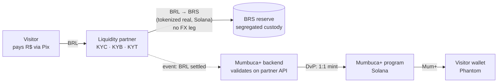
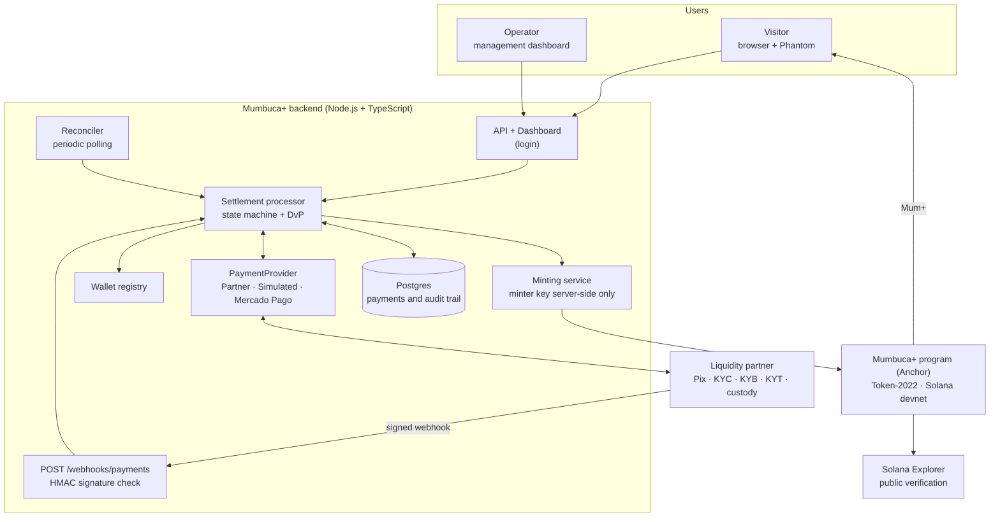
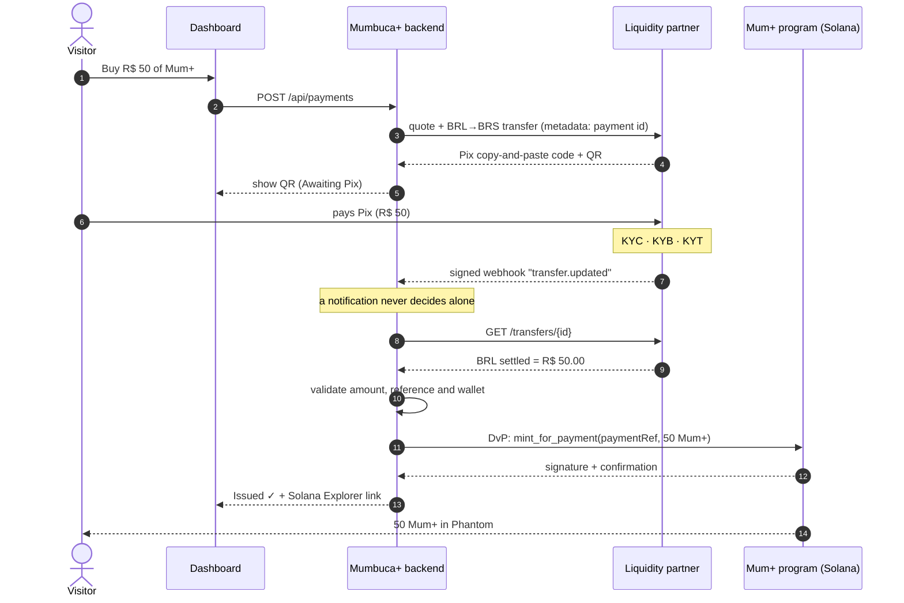
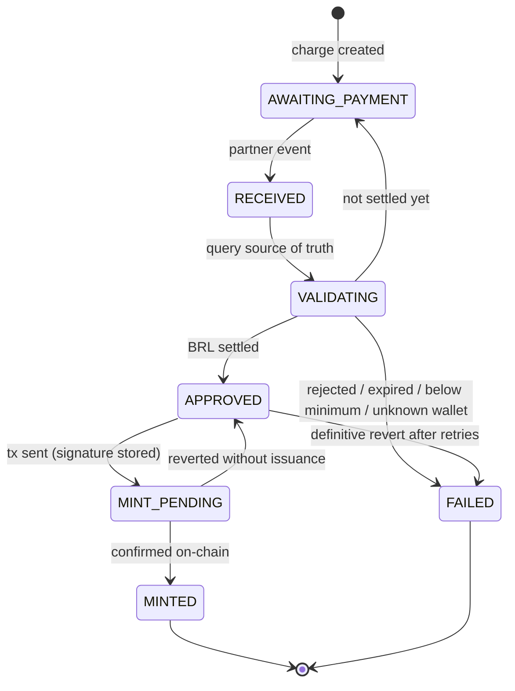

# Mumbuca+

[🇧🇷 Português](README.md) · 🇺🇸 English

**Tokenization infrastructure for social currencies: a payment in Brazilian reais, settled by a regulated partner, automatically becomes Mum+ in the visitor's wallet, ready to spend in Maricá with benefits and discounts. Delivery is conditioned on payment (DvP) and compliance is built in by design. Under the proposal, part of the operation's profit funds cinema and culture in the city.**

> Proof of concept for the **Mumbuca+** proposal, based on the report *"Renda Básica de Cidadania — Mumbuca"* (Faculdade Sebrae, Business Administration, class T9, Entrepreneurship & Social Impact, 2026). It is not an official system of the City of Maricá or of Banco Comunitário Mumbuca. It runs on **Solana devnet**.

---

## Contents

1. [The problem](#1-the-problem)
2. [What Mumbuca+ does](#2-what-mumbuca-does)
3. [The money route: BRL → BRS → Mumbuca+](#3-the-money-route-brl--brs--mumbuca)
4. [Liquidity and compliance partner](#4-liquidity-and-compliance-partner)
5. [Legal thesis: Mum+ is a utility token of the Maricá ecosystem](#5-legal-thesis-mum-is-a-utility-token-of-the-maricá-ecosystem)
6. [Financial-market principles applied](#6-financial-market-principles-applied)
7. [Compliance by design](#7-compliance-by-design)
8. [Architecture](#8-architecture)
9. [End-to-end flow](#9-end-to-end-flow)
10. [Web3 engineering and security](#10-web3-engineering-and-security)
11. [The smart contract and the Mum+ token](#11-the-smart-contract-and-the-mum-token)
12. [How this strengthens the public policy](#12-how-this-strengthens-the-public-policy)
13. [Proof-of-concept scope](#13-proof-of-concept-scope)
14. [Repository layout and documentation](#14-repository-layout-and-documentation)
15. [References](#15-references)

---

## 1. The problem

Mumbuca is the social currency of Maricá, in the state of Rio de Janeiro, Brazil. It was created in 2013, is managed by Banco Comunitário Mumbuca (a community bank), is pegged 1:1 to the Brazilian real (1 Mumbuca = R$ 1.00) and funds the city's Basic Citizenship Income program. According to the report, in 2026 the program serves **more than 93,000 beneficiaries**, pays **230 Mumbucas per month** and moves an annual budget **above R$ 256 million**.

Today Mumbuca circulates in a closed arrangement aimed at benefit recipients. **Mumbuca+** opens the social currency to an **external audience**: tourists and visitors buy Mum+ via Pix to spend in Maricá's accredited network, with access to **benefits and discounts**. Money from outside the city flows straight into local businesses, and under the proposal **part of the profit** goes to **cinema and culture** in the city.

The report identifies bottlenecks that technology can address:

| Bottleneck (report) | How tokenization helps |
|---|---|
| Physical processes: plastic cards and thermal paper | 100% digital balances and receipts, verifiable on-chain |
| Manual traceability and accountability | Every issuance has a public signature anyone can audit |
| Closed payment arrangement, hard to integrate | Open standard (SPL Token-2022) that plugs into wallets and payment institutions |
| Fiscal dependence on public transfers only | Selling Mum+ to visitors brings outside money into the local economy and generates own revenue, part of it earmarked for culture |
| Currency limited to residents and beneficiaries | Visitors buy Mum+ via Pix and use it in the same accredited network, with benefits and discounts |

The report proposes a **tokenized dual wallet**. This repository builds its **technical foundation**: an automatic, auditable and compliant bridge between money entering through the payment system and the token reaching whoever will spend it in Maricá.

## 2. What Mumbuca+ does

**Who it is for:** visitors and tourists coming to Maricá. They buy Mum+ and get **benefits and discounts** in the city's accredited network:
- dining;
- lodging;
- culture and cinema;
- local shops, with 5% cashback on purchases.

Every purchase also supports local culture. In the proof of concept, the benefits shown in the app are **illustrative**.

1. The visitor picks an amount and **buys Mum+ via Pix**, Brazil's instant payment system.
2. The **liquidity partner** receives the reais, with KYC, KYB and KYT applied at the entry point.
3. The Mumbuca+ backend **detects settlement**, through a signed webhook or periodic polling, and **confirms it directly against the partner's API**. A notification alone never triggers issuance.
4. Once the payment is settled, the backend calls `mint_for_payment` on the Solana program: **delivery versus payment (DvP)**.
5. **Mumbuca+ (Mum+) shows up in the visitor's Phantom wallet**, 1 Mum+ for every R$ 1.00 settled.
6. The transaction is **public and verifiable** on Solana Explorer.
7. No payment is ever minted twice, even with redeliveries, network failures or server restarts.
8. With Mum+, the visitor spends in Maricá's accredited network and enjoys the program's benefits and discounts.

**In the public demo,** the visitor signs in with their Phantom wallet and creates an account with a display name. The Pix in steps 2 and 3 is simulated by the backend itself, with the "Pagar agora (demonstração)" button. The issuance in step 4 is real: the smart contract on Solana devnet issues the Mum+ to the visitor's wallet (see section 11). The liquidity-partner integration is ready and follows the same path; only the provider changes.

### Try it yourself

Site: https://mumbuca-plus-production.up.railway.app

1. In Phantom, switch to Devnet: Settings → Developer settings → Testnet mode → Solana Devnet.
2. On the site, click **Entrar com Phantom** (sign in with Phantom). You sign a message. No transaction is authorized.
3. Click **Criar conta** (create account) and pick a display name.
4. Click **＋ Comprar Mum+** (buy Mum+), choose an amount and click **Gerar Pix**.
5. Click **Pagar agora (demonstração)** (pay now, demo).
6. The Mum+ shows up in Phantom (Devnet) and on Solana Explorer.

No real money is used; everything runs on Solana devnet. You can check the contract and the token on Solana Explorer: [program](https://explorer.solana.com/address/HfFamsTJgSXssGkCgBqtNsDLD694peLYBbAzs4kuYzZm?cluster=devnet) and [Mum+ token](https://explorer.solana.com/address/8kHEAtmxYof8GCw2LhoKLLg5DmJGaR1qkuBH2qdMSBuk?cluster=devnet).

Limits: R$ 11 to R$ 100 per purchase, 3 purchases per wallet per 24 h, 1 pending purchase at a time and R$ 2,000 in total across all visitors per 24 h. An unpaid purchase expires after 30 minutes. Purchases may pause automatically (for example, once the daily total is reached).

## 3. The money route: BRL → BRS → Mumbuca+



- **BRL:** the visitor pays in reais via Pix, the currency they already use.
- **BRS:** the liquidity partner converts the reais into **BRS**, a real-referenced token on Solana. The BRL→BRS conversion has **no foreign-exchange leg**: no quote against a foreign currency, no FX lock, and a 1:1 rate within the same monetary standard. The BRS is held in **segregated custody** and forms the **reserve in reais** backing issuance.
- **Mumbuca+:** once BRL settlement is confirmed, the system issues **Mum+ in the same amount in reais** to the visitor's wallet. Mum+ is the **social-currency layer**, where public-policy rules apply:
  - territory (only Maricá's accredited network);
  - benefits and discounts for visitors;
  - incentives for local commerce;
  - part of the profit earmarked for culture.

End to end, **value is always denominated in reais**: BRL, then BRS (tokenized real), then Mum+ (a social currency pegged to the real). **No leg involves a foreign currency.** And the whole route runs on a single network: BRS and Mum+ both live on Solana.

### Reserve and yield management

The reserve backing Mum+ does not sit idle. The proposal's model is:

| Portion | Where it sits | Why |
|---|---|---|
| **Backing (100% of Mum+ in circulation)** | Floating-rate Brazilian federal government bonds (Tesouro Selic) and cash in reais | To guarantee 1:1 redemption at any time: these are highly liquid, sovereign-risk assets |
| **Surplus (anything above 100%)** | Part of it in *staking* on the Solana network | Extra yield without putting the backing at risk, since staking has unbonding periods and protocol risk |

**The yield belongs to the issuer, not the holder.** Bond interest and staking rewards stay with the program operator and fund:
- the **5% cashback** on purchases in the accredited network;
- the share earmarked for **cinema and culture** in Maricá;
- operating costs.

A Mum+ holder **receives nothing for holding a balance**. Benefits come only from **spending** in the accredited network. This separation supports the legal thesis in section 5: with no expectation of profit for the holder, Mum+ is not a security.

> **Environments:** the same BRL → BRS → Mumbuca+ route runs in the partner's test environment (simulated Pix) and in production (real Pix, minimum R$ 11). The reserve asset (BRS) is set by a single environment variable.

## 4. Liquidity and compliance partner

Mumbuca+ **does not hold money, convert currencies or process Pix itself**. Those functions sit with a **regulated liquidity partner**, integrated by Peragus, which already runs this integration in production. The partner provides:

- **Liquidity:** receiving Pix in reais and converting BRL→BRS.
- **Custody:** segregated custody of the reserve.
- **KYC** (*Know Your Customer*): identification and verification of individuals.
- **KYB** (*Know Your Business*): identification and verification of legal entities, including ultimate beneficial owners.
- **KYT** (*Know Your Transaction*): transaction monitoring and screening, tracing the source and destination of funds.
- **AML/CFT:** anti-money-laundering and counter-terrorist-financing controls, with sanctions and restricted-list screening.
- **Signed settlement events:** webhooks with HMAC-SHA256, plus a **query API** that serves as the source of truth.

| Responsibility | Performed by |
|---|---|
| Receive Pix and settle in reais | Liquidity partner |
| KYC, KYB, KYT, AML/CFT and sanctions | Liquidity partner |
| Convert BRL into BRS and hold the reserve | Liquidity partner |
| Notify settlement (signed webhook + query API) | Liquidity partner |
| Validate settlement, execute DvP and issue the social currency | Mumbuca+ |
| Public-policy rules (territory, benefits and discounts, earmarking for culture) | Ecosystem governor (City and community bank) |

**Why this design:**
- **Segregation of duties:** the regulated financial activity stays with the party that holds the license, the infrastructure and the responsibility for it. Mumbuca+ owns the public-policy layer.
- **Provider-agnostic:** the issuance core only knows the `PaymentProvider` interface. The current partner, Mercado Pago (designed, not yet integrated) and a simulated provider are interchangeable adapters.
- **Reuse with controlled risk:** the integration comes from code Peragus already runs in production.

## 5. Legal thesis: Mum+ is a utility token of the Maricá ecosystem

### 5.1 The thesis

**Mumbuca+ (Mum+) is a utility token** of Maricá's social-currency ecosystem. It gives its holder access to products and services in the city's accredited network, under the rules of a public program. It therefore falls **outside the legal definition of "virtual asset"** in Brazilian Law 14,478/2022, and so outside the foreign-exchange rules that apply to virtual-asset service providers. **The token is governed by the ecosystem's own governor:** the City of Maricá, through municipal law, and Banco Comunitário Mumbuca, which operates the network.

### 5.2 Grounds

1. **The law expressly excludes utility tokens from the definition of virtual asset.**
   - Article 3 of Law 14,478/2022 defines a virtual asset as *"a digital representation of value that can be traded or transferred electronically and used for payments or for investment purposes"*.
   - Item III then excludes *"instruments that give their holder access to specified products or services, or to a benefit arising from them, such as points and rewards of loyalty programs"*.
2. **Mum+ is an instrument of access to specified benefits.**
   - It is accepted only within Maricá's accredited network.
   - It gives visitors the benefits and discounts defined by the program's governor: dining, lodging, culture and cinema, local shops.
   - Like loyalty points and rewards, it has value within an ecosystem defined by whoever administers it.
   - The 5% cashback on purchases in the accredited network is of the same kind: a spending benefit, as in a loyalty program.
3. **There is no investment purpose.**
   - The peg is fixed (1 Mum+ = R$ 1.00).
   - The holder receives no yield, appreciation, interest or share of profits.
   - There is no public offering and no secondary market promoted by the issuer.
   - The reserve's yield (government bonds and staking of the surplus) belongs to the issuer and pays spending benefits, never a return on balances.
   - In Guidance Opinion 40/2022, the Brazilian Securities Commission (CVM) separates utility tokens from tokens that are securities by the absence of an expectation of profit from the efforts of others. Section 5.3 applies the Howey Test element by element.
4. **No virtual asset means no virtual-asset FX.**
   - Article 76-A of Central Bank Resolution 277/2022, added by Resolution 521/2025, brings the *provision of virtual-asset services* into the foreign-exchange market.
   - Because Mum+ is not a virtual asset, its issuance and circulation fall outside that rule.
   - Moreover, no step of the route involves a foreign currency.
5. **The ecosystem's governor regulates the token.**
   - Mumbuca is a social currency established and governed by the City of Maricá (the report cites Municipal Law 3,673/2025) and operated by Banco Comunitário Mumbuca.
   - Merchant accreditation, usage rules, limits and issuance against incoming reais are that governor's decisions. Mumbuca+ simply carries those rules onto a token.
   - Social currencies have followed this model since Banco Palmas (1998): **backing in reais, 1:1 peg, territorial circulation and no legal-tender status**, as the Central Bank itself describes.
6. **Each layer has its own regulator.** The financial operation sits with the party regulated for it:

| Layer | Instrument | Nature | Regulated by / accountable |
|---|---|---|---|
| Entry | BRL via Pix | national currency | Central Bank (Pix) and the receiving institution (liquidity partner) |
| Reserve | BRS | real-referenced asset | Liquidity partner, under the virtual-asset service provider regime |
| Use | Mum+ | social-currency utility token | City of Maricá and Banco Comunitário Mumbuca |

### 5.3 The Howey Test: Mum+ is not a security

The **Howey Test** (*SEC v. W. J. Howey Co.*, 328 U.S. 293, 1946) is the classic test for whether something is an investment contract, that is, a security. Brazilian law follows the same logic in the concept of a **collective investment contract** in Law 6,385/1976, Article 2, item IX: a publicly offered instrument or contract that gives a right to participation, partnership or remuneration *"whose returns come from the efforts of the entrepreneur or of third parties"*. The CVM applies this reasoning to crypto-assets in Guidance Opinion 40/2022.

There is a security only when **all four elements** are present at once:

| Howey element | For Mum+ | Present? |
|---|---|---|
| 1. Investment of money | There is a payment in reais, but for **consumption**: the visitor receives the same value in Mum+ to spend in the network. When the purchase is motivated by use or consumption, there is no investment (*United Housing Foundation v. Forman*, 421 U.S. 837, 1975) | Payment, but not an investment |
| 2. Common enterprise | Each holder's balance does not depend on the results of a common pool: 1 Mum+ is worth R$ 1.00 regardless of how the reserve performs | No |
| 3. **Expectation of profit** | No interest, yield, appreciation or profit share. The reserve's yield stays with the issuer. Benefits (discounts and 5% cashback) depend on **spending**, not on the balance held | **No** |
| 4. Profit from the efforts of others | With no profit for the holder, there is no profit from others' efforts | No |

Without an expectation of profit the test fails, and Mum+ **is not a security**. It remains an instrument of access to specified benefits (Law 14,478/2022, Article 3, item III).

The same criterion is applied abroad to fixed-peg tokens backed by government bonds: in 2025 the SEC's Division of Corporation Finance took the view that stablecoins backed by liquid assets, redeemable 1:1 and **paying no yield to holders** are not securities.

**Rules that keep Mum+ outside Howey (which the project commits to):**
- **No yield on balances.** Cashback and discounts are always proportional to **spending** in the accredited network, never to the balance held or time in the wallet.
- **Staking belongs to the issuer.** It applies to the reserve surplus and is not offered to holders. There is no "stake" button for visitors and no reward for locking Mum+.
- **Consumption messaging.** Mum+ is never promoted as an investment, an application of funds or a way to make money.
- **Fixed peg and 1:1 redemption.** With no possible appreciation, there is no capital gain.

If holders ever started receiving part of the yield for holding a balance, element 3 would be present and Mum+ would have to be treated as a security, under the CVM. That is why this line stays out of the product.

### 5.4 How the technical design reinforces the thesis

- **DvP (Delivery versus Payment):** Mum+ is delivered only against confirmed settlement in reais. There is no pre-minting, pre-sale or public offering. Supply is created exclusively from payments settled and validated at the source.
- **Fixed peg, no price formation:** the system runs no order book, no quotes and no trading.
- **On-chain governance by the ecosystem governor:** the admin and pauser roles belong to the governor, who can suspend issuance and adjust limits.
- **Utility specified in code:** the next step is to restrict Mum+ transfers to accredited wallets (accredited merchants and visitor wallets) with a Token-2022 *transfer hook*. That makes the "specified utility" of Article 3, item III verifiable on-chain.

### 5.5 Anticipated objections

- **"A reserve invested in government bonds and staking produces an economic gain, so Mum+ is a security."**
  - The gain exists, but it belongs to the **issuer**, who manages the reserve.
  - Under Howey what matters is the **holder's** expectation of profit, and there is none: the holder gets exactly R$ 1.00 per Mum+ and benefits only when spending.
  - It is the same arrangement as an institution that invests customers' account balances and keeps the yield.

- **"A real-pegged token accepted across a network is a means of payment."**
  - Mum+ circulates only within an accredited network defined by the public governor, as access to a program benefit. That is exactly the case covered by Article 3, item III.
  - Restricting transfers to accredited wallets makes that boundary verifiable on-chain.
- **"A city cannot issue currency."**
  - Mum+ is not currency. Issuing currency is a federal power (Federal Constitution, Art. 21, VII), and only the Union may legislate on the monetary system (Art. 22, VI).
  - Mum+ is an instrument of a municipal program **with no legal-tender status**: nobody is obliged to accept it.
- **"Buying BRS could be FX under Article 76-A, IV."**
  - The BRS is acquired by the liquidity partner, which provides the virtual-asset service and complies with its own regime.
  - That does not change the nature of Mum+, nor does it turn the Mumbuca+ ecosystem into an FX operation.

## 6. Financial-market principles applied

| Principle | How it appears in Mumbuca+ |
|---|---|
| **DvP (Delivery versus Payment)** | The asset (Mum+) is delivered only after the payment (BRL) settles, which removes principal risk: nobody receives tokens without having paid |
| **Settlement finality** | BRL counts as settled only on the partner's official status. Mum+ counts as delivered only after the transaction is confirmed on the network (`confirmed` commitment) |
| **1:1 backing and segregated reserve** | Each Mum+ corresponds to R$ 1.00 received, held as BRS in the partner's segregated custody |
| **Reserve management (treasury)** | Backing in floating-rate federal government bonds and cash, highly liquid for 1:1 redemption. Only the surplus goes to staking. The yield belongs to the issuer and funds the 5% cashback and culture |
| **Golden source** | The partner's API is the official source for the payment. The webhook only notifies and never decides |
| **Idempotency and exactly-once** | Each payment produces at most one issuance, guaranteed by the database and the program (one on-chain receipt per `paymentRef`) |
| **Continuous reconciliation** | A reconciler periodically compares local state with the partner and the chain, and resumes anything pending |
| **Audit trail** | Every state transition and every incoming event is recorded append-only, with the original payload |
| **Settlement state machine** | `AWAITING_PAYMENT → RECEIVED → VALIDATING → APPROVED → MINT_PENDING → MINTED` (or `FAILED`), with atomic transitions |
| **Minor units** | All amounts are handled as integer cents, with no floating point and no rounding errors |
| **Exposure limits** | Supply cap, per-issuance limit, and minimum and maximum amount per purchase |

## 7. Compliance by design

- **KYC, KYB and KYT at the door:** every real that enters passes through the liquidity partner's controls before any issuance exists.
- **AML/CFT:** the architecture follows Brazilian Law 9,613/1998.
  - The partner identifies the source of funds.
  - The destination is traceable on-chain.
  - The audit trail is complete, from the event to the on-chain signature.
- **Travel Rule (FATF Recommendation 16):** the link between payer, payment and destination wallet is recorded end to end.
- **LGPD (Brazil's data-protection law, 13,709/2018) and data minimization:**
  - The Mumbuca+ layer stores only what it needs: an identifier, the wallet, amounts and events.
  - Civil identification stays with the regulated partner.
  - The demo uses fictitious data only and no CadÚnico (Brazil's social-programs registry) data.
- **Segregation of duties and least privilege:**
  - The key that administers the program is separate from the account that mints.
  - The minter can only mint.
  - The governor holds the admin and pauser roles.
- **Circuit breaker:** the emergency pause suspends new issuance without affecting balances.
- **Key management:** the minting key lives only on the server, in an environment variable. It is never in the browser or the repository.
- **Transparency for oversight bodies:**
  - Every issuance has a public signature verifiable on the explorer.
  - The operator dashboard shows each payment's origin, amounts, state and any discrepancies.

## 8. Architecture



| Module | Responsibility |
|---|---|
| Anchor program | Controlled issuance, supply cap, pause and an on-chain receipt per payment (duplicate-issuance protection) |
| PaymentProvider | Single interface for any payment institution or liquidity partner |
| Webhook handler | Receives events, verifies the signature, records them without trusting the payload |
| Validator | Queries the payment on the partner's official API and checks status, amount and reference |
| Wallet registry | Links each user (fictitious in the demo) to a validated Solana address (base58 public key) |
| Minting service | Simulates, sends `mint`, tracks confirmation, recovers from failures without duplicating |
| Transaction database | Complete, auditable history of every payment and transition |
| Dashboard | Entry screen with Phantom sign-in and account creation; visitor "My wallet" (balance, buying Mum+, benefits in Maricá, history); password-protected operator view (all payments, signatures, actions) |

**Sign-in and scoping.** Visitors sign in by message signature (SIWS-style): the server issues a challenge with a single-use nonce, valid for 5 minutes and stored server-side, and verifies the ed25519 signature. The session carries a role (operator or visitor), and the server scopes every visitor request to the visitor's own data: another person's resource returns 404 and an operator route returns 403. The look uses [Spell UI](https://spell.sh) (MIT): AnimatedGradient and PopButton.

**Stack:**
- Program: Rust and Anchor 1.2.
- Token: SPL Token-2022 with on-chain metadata.
- Deployment: Solana/Anchor CLI.
- Wallet: Phantom.
- Backend: Node.js 22, TypeScript, Fastify and Postgres.
- Blockchain client: `@solana/web3.js`.
- Dashboard: React and Vite.
- Hosting: Railway.

## 9. End-to-end flow



### Per-payment state machine



Transient failures do **not** lead to `FAILED`. These include network instability, timeouts and the partner being unavailable. The payment stays in its current state and the reconciler retries.

## 10. Web3 engineering and security

**Zero duplicate issuance, in four layers:**
1. Every partner event is recorded by its identifier, and repeats are discarded.
2. Every payment changes state through a conditional, atomic Postgres update. This is safe under concurrency between the webhook and the reconciler.
3. Before retrying an uncertain issuance, the backend checks whether that payment's on-chain receipt (PDA) already exists, and recovers the signature from the receipt's first transaction. If the transaction expired without a receipt, resending is safe.
4. **In the program itself:** `mint_for_payment` creates a receipt account (PDA `["receipt", paymentRef]`) per payment. A second issuance with the same `paymentRef` fails on the network itself. This final guarantee does not depend on the backend.

**On-chain engineering practices:**
- **Deterministic `paymentRef`:** `keccak256("<provider>:<payment id>")` ties each issuance uniquely and verifiably to the payment that originated it. It is also the seed of the receipt PDA.
- **PDAs (Program Derived Addresses):** the config, the mint and every receipt are program-derived accounts (`["config"]`, `["mint"]`, `["receipt", paymentRef]`). The mint authority is the config PDA, so no private key can issue Mum+ outside the program's rules.
- **Role-based access control** in program state: separate `admin`, `minter` and `pauser`.
- **Custom program errors** (`Unauthorized`, `Paused`, `InvalidAmount`, `ExceedsMaxPerTx`, `CapExceeded`): decoded by the backend to decide between retrying and failing.
- **Simulate before send:** every transaction is simulated (`simulateTransaction`) before broadcast, so a predictable rejection never reaches the network.
- **Failure classification and blockhash expiry:**
  - a program error is definitive;
  - network errors, timeouts and lack of SOL are transient;
  - if a transaction expires with no on-chain receipt, resending is provably safe.
- **Token-2022 with on-chain metadata:** name and symbol stored in the mint itself, with no external services.
- **Events** (`MintedForPayment`) for auditing and indexing.
- **Validated addresses** (32-byte base58 public keys) in the wallet registry.
- **Testing:**
  - the program is tested in Rust against the Solana runtime (SVM);
  - the backend is built test-first (vitest), including real integration tests against a local validator.

**Further guarantees:**
- **Nothing is minted just because a notification arrived.** The payment is always confirmed at the source of truth.
- Webhooks are authenticated with HMAC-SHA256, a time window and constant-time comparison.
- The program limits the damage from a leaked key: total cap, per-issuance limit and an emergency pause.

**Public-site protections.** Anyone with a Phantom wallet on devnet can try the site, so the server protects access and the minter wallet:
- **Sign-in by signature:** the visitor signs a message carrying a single-use code that is valid for 5 minutes. The signature authorizes no transaction, and the server stores only the wallet address and a display name.
- **Each visitor's own data:** a visitor sees only their own balance and purchases. Operator functions stay behind a password.
- **Purchase limits:**
  - R$ 11 to R$ 100 per purchase;
  - 3 purchases per wallet every 24 h;
  - R$ 2,000 in total across all visitors every 24 h;
  - one pending purchase at a time, which expires after 30 minutes.
  Purchases sent at the same time are processed one at a time, so no one can get past the limits.
- **Attempt limits** per visitor account and per IP, with a cap on new accounts per IP per day. The IP is stored only as a hash.
- **Automatic pause:** purchases stop by themselves when the minter wallet runs low on SOL, when minting is paused in the contract, or when the on-chain configuration differs from the expected one.

## 11. The smart contract and the Mum+ token

The Mumbuca+ smart contract is a **Solana program written in Rust with Anchor 1.2** (`anchor/programs/mumbuca_plus`). It is the only way to create Mum+. It **issues the token only against a settled payment**, once per payment, within limits stored on-chain.

### Addresses on Solana devnet

| Account | Address | What it is |
|---|---|---|
| Program | [`HfFamsTJgSXssGkCgBqtNsDLD694peLYBbAzs4kuYzZm`](https://explorer.solana.com/address/HfFamsTJgSXssGkCgBqtNsDLD694peLYBbAzs4kuYzZm?cluster=devnet) | The `mumbuca_plus` smart contract |
| Mum+ mint | [`8kHEAtmxYof8GCw2LhoKLLg5DmJGaR1qkuBH2qdMSBuk`](https://explorer.solana.com/address/8kHEAtmxYof8GCw2LhoKLLg5DmJGaR1qkuBH2qdMSBuk?cluster=devnet) | The Mum+ token (Token-2022), PDA `["mint"]` |
| Configuration | [`ULjPXhucQKj89cRsMSbejQktWeqYqRdyWTD7jnWo4ZX`](https://explorer.solana.com/address/ULjPXhucQKj89cRsMSbejQktWeqYqRdyWTD7jnWo4ZX?cluster=devnet) | PDA `["config"]`: holds roles, limits and state. It is also the mint authority |
| Admin and pauser | [`CynA6i1MpS1HvE8kwaCsFx6cEzzQ5Vv1zxuPMZAAZmSV`](https://explorer.solana.com/address/CynA6i1MpS1HvE8kwaCsFx6cEzzQ5Vv1zxuPMZAAZmSV?cluster=devnet) | The governor's account. It can also upgrade the program |
| Minter | [`5zB8nAJqHA6chMg27iiR3Md6aXL5WgmFY7z9ri25FzDT`](https://explorer.solana.com/address/5zB8nAJqHA6chMg27iiR3Md6aXL5WgmFY7z9ri25FzDT?cluster=devnet) | The backend's account, the only one that can request an issuance |

### What the contract does

| Instruction | Who can call it | What it does |
|---|---|---|
| `initialize` | Whoever deploys (becomes admin) | Creates the configuration and the Mum+ mint with name, symbol and 2 decimals. Sets the total cap, the per-issuance limit, the minter and the pauser |
| `mint_for_payment(payment_ref, amount)` | Minter only | Issues `amount` Mum+ to the buyer's wallet for a settled payment. Creates the wallet's token account if it does not exist yet |
| `pause` / `unpause` | Pauser only | Suspends or resumes **new issuance**. Balances and transfers are not affected |
| `set_minter`, `set_pauser`, `set_max_mint_per_tx` | Admin only | Changes the minter, changes the pauser and adjusts the per-issuance limit |
| `set_metadata_uri(uri)` | Admin only | Points the token metadata at the JSON with the logo (up to 200 bytes; `UriTooLong` above that) |

Before each issuance, the program checks that:
- the signer is the minter (otherwise `Unauthorized`);
- issuance is not paused (`Paused`);
- the amount is greater than zero (`InvalidAmount`);
- the amount is within the per-issuance limit (`ExceedsMaxPerTx`);
- the total issued stays within the cap (`CapExceeded`), with checked arithmetic (`MathOverflow`).

**One payment, one issuance.** Each issuance creates a receipt account, the PDA `["receipt", payment_ref]`, holding the payment reference, the recipient, the amount and the slot. Any attempt to issue again for the same payment fails on the network itself. The `payment_ref` is `keccak256("<provider>:<payment id>")`.

**No one can issue outside the rules.** The mint authority is the configuration PDA, which only the program itself controls. No private key can create Mum+ outside these rules. The mint has **no freeze authority**, so no account's balance can be frozen.

**Audit.** Each issuance emits the `MintedForPayment` event, with recipient, amount, payment reference and slot. Anyone can check the transaction on Solana Explorer.

### The Mum+ token

| Property | Value |
|---|---|
| Nature | Utility token of Maricá's social-currency ecosystem (see section 5) |
| Standard | SPL Token-2022, with metadata stored in the mint itself (MetadataPointer and TokenMetadata) |
| Name / symbol | Mumbuca+ / Mum+ |
| Decimals | 2. 1 unit = R$ 0.01, so cents map to units with no conversion |
| Mint authority | The program's configuration PDA |
| Freeze authority | None |
| Logo and metadata | [mum.json](https://mumbuca-plus-production.up.railway.app/token/mum.json), with the official petrol-green logo |
| Initial supply | 0. Everything is issued against settled payment (DvP) |
| Supply cap | 10,000,000 Mum+ |
| Per-issuance limit | 20,000 Mum+ (adjustable by the admin) |
| Roles | Admin (governor), Minter (backend), Pauser (governor) |
| Network | Solana devnet |

**Peg:** 1 Mum+ = R$ 1.00.

**Program tests:** 20 Rust tests against the Solana runtime (LiteSVM). They cover allowed issuance and each rejection: wrong minter, pause, zero amount, per-issuance limit, cap, a repeated payment and a metadata change by someone who is not the admin.

### Build verification (reproducible build)

Anyone can confirm that the program on devnet was built **exactly** from this repository, without trusting the author:

| Item | Value |
|---|---|
| Source commit | [`2fbe1ff`](https://github.com/Peragus01/Mumbuca-plus/commit/2fbe1ffe05fbb67150be137d8444892f2b020f4b) (`anchor/` folder) |
| Environment | Official Solana Foundation Docker container (`solana-verify`), Solana 4.1.2 |
| Hash of the built program | `2ec3700b775207c75550e0117baff4cc4bc8ae206add48e80b3fde3dda4af50b` |
| Hash of the program on devnet | `2ec3700b775207c75550e0117baff4cc4bc8ae206add48e80b3fde3dda4af50b`, identical |
| On-chain verification record | [devnet transaction](https://explorer.solana.com/tx/56MPoLPXaMpMD8oy7Kn5Mxg5jiNrwikrFpdTC9XvjijksR4bKBqy5CyR6Sw4Kt9JjWsFfRfRpstpWbgtZwDr8GHY?cluster=devnet), signed by the upgrade authority |

To reproduce (requires Docker and `cargo install solana-verify`):

```bash
solana-verify verify-from-repo -u devnet --program-id HfFamsTJgSXssGkCgBqtNsDLD694peLYBbAzs4kuYzZm https://github.com/Peragus01/Mumbuca-plus --commit-hash 2fbe1ffe05fbb67150be137d8444892f2b020f4b --library-name mumbuca_plus --mount-path anchor
```

The command rebuilds in the official container and compares the result with what is on the network. The expected result is `Program hash matches ✅`. Solana Explorer's "Verified Build" badge depends on OtterSec's service, which currently covers mainnet only; on devnet, the proof is this hash comparison, which anyone can repeat.

## 12. How this strengthens the public policy

| Report objective | Mumbuca+ contribution |
|---|---|
| Modernization and digitalization | Social currency on an open standard, with no cards or paper |
| Traceability | Every real that enters produces a public, auditable issuance |
| Integration with payment institutions | Pluggable providers: Pix today, others tomorrow |
| Financial inclusion | Works with Pix and a digital wallet, without a traditional bank account |
| Operational sustainability | Less manual service and physical logistics, plus own revenue from selling Mum+ to visitors and from partnerships |
| Tourism | Visitors buy Mum+ and spend it in Maricá's accredited network, with benefits and discounts |
| Culture | Under the proposal, part of the operation's profit, including the reserve's yield, goes to cinema and culture in the city |
| Local economy | Mum+ is the layer for territory and incentive rules: 5% cashback on purchases in the accredited network, paid from the reserve's yield, and controlled external credit (a future module in the report) |
| Transparency and oversight | Management dashboard plus a public explorer for oversight bodies |

## 13. Proof-of-concept scope

**In scope:**
- Anchor program and Token-2022 token on Solana devnet.
- Buying Mum+ via Pix through the liquidity partner, in the test and production environments (R$ 11).
- Validation at the source of truth.
- Automatic, idempotent DvP.
- A public site with Phantom sign-in, account creation and demo purchases, with limits and an automatic pause.
- Visitor "My wallet" with an illustrative "Benefits in Maricá" section, and the operator dashboard.
- A simulated provider for the public demo and as a fallback.

**Future phases:**
- Restricting transfers to accredited wallets (Token-2022 transfer hook).
- Dual wallet and 5% cashback on spending.
- Reserve management: investing the backing in federal government bonds and staking the surplus, with the yield going to cashback and culture.
- 25% external credit.
- Own card terminals.
- AI assistant.
- Mercado Pago integration.
- A real network of accredited businesses and a benefits catalogue.
- The mechanism that earmarks part of the profit for culture.
- Redemption of Mum+ into reais.
- On-chain proof of reserves.
- Mainnet.

**Status:** implementation is complete and published. The contract is on Solana devnet (addresses in section 11), and the app (backend and dashboard) is live at https://mumbuca-plus-production.up.railway.app, open to anyone with Phantom on devnet. The demo uses the simulated provider. The liquidity-partner integration is ready and only needs credentials.

Project documents (in Portuguese):
- [MVP design](docs/superpowers/specs/2026-11-23-mumbuca-plus-mvp-design.md) and [plan](docs/superpowers/plans/2026-11-23-mumbuca-plus-mvp.md);
- [visual redesign](docs/superpowers/specs/2026-11-24-redesign-c2-design.md);
- [visitor accounts with Phantom sign-in](docs/superpowers/specs/2026-11-25-visitor-phantom-login-design.md) and [plan](docs/superpowers/plans/2026-11-25-visitor-phantom-login.md).

## 14. Repository layout and documentation

```
anchor/        mumbuca_plus program (Rust/Anchor) and tests
backend/       API, webhook, processor, minting (Node.js + TypeScript)
frontend/      dashboard (React + Vite)
docs/
  superpowers/specs/   design documents
  superpowers/plans/   implementation plans
  solana-deploy.md     devnet deployment guide
  demo-runbook.md      demo script and contingencies
```

### Prerequisites

- Node.js 22 and npm.
- A reachable PostgreSQL (local or Railway).
- For the on-chain program: WSL (Ubuntu) with the Solana CLI and Anchor, and the Rust toolchain.
- Environment variables: copy `backend/.env.example` to `backend/.env` and fill it in (never commit that file).

### Run locally

```bash
npm ci
npm run dev:api   # API at http://localhost:3000
npm run dev:web   # dashboard at http://localhost:5173 (proxies to the API)
```

Production build (the API serves the compiled dashboard). Over local http, use `NODE_ENV=development` so the session cookie does not require HTTPS:

```bash
npm ci && npm run build && npm start
```

### Tests

```bash
npm test -w backend
npm test -w frontend
npm run test:chain -w backend   # integration against solana-test-validator in WSL
# Anchor program, in WSL, inside anchor/:
cargo test
```

### Deploy the program to devnet

See [docs/solana-deploy.md](docs/solana-deploy.md) (in Portuguese).

### Deploy to Railway and demo

`railway.json` at the root configures build, start and healthcheck. The deploy steps, the eve-of-demo checklist, the presentation script and the contingencies are in [docs/demo-runbook.md](docs/demo-runbook.md) (in Portuguese).

## 15. References

- Report *"Renda Básica de Cidadania — Mumbuca"*. Faculdade Sebrae, 2026. Includes the FGV, UFF, Banco Mumbuca, CODEMAR and City of Maricá sources it cites.
- Brazil. **Federal Constitution**, Art. 21, VII and Art. 22, VI (federal power over currency and the monetary system).
- Brazil. **Law 14,478/2022**, the legal framework for virtual-asset service providers. Art. 3 defines virtual assets and their exclusions. [planalto.gov.br](https://www.planalto.gov.br/ccivil_03/_ato2019-2022/2022/lei/l14478.htm)
- Brazil. **Law 12,865/2013**, payment arrangements and payment institutions.
- Brazil. **Law 9,613/1998**, anti-money laundering.
- Brazil. **Law 13,709/2018** (LGPD), personal data protection.
- Central Bank of Brazil. **Resolutions 519, 520 and 521/2025**, covering virtual-asset service providers and the inclusion of virtual-asset operations in the foreign-exchange market (Art. 76-A of Resolution 277/2022). [Resolution 521 text](https://www.bcb.gov.br/estabilidadefinanceira/exibenormativo?tipo=Resolu%C3%A7%C3%A3o%20BCB&numero=521)
- Brazilian Securities Commission (CVM). **Guidance Opinion 40/2022**, crypto-assets and the securities market.
- Brazil. **Law 6,385/1976**, Article 2, item IX: collective investment contracts as securities.
- U.S. Supreme Court. ***SEC v. W. J. Howey Co.***, 328 U.S. 293 (1946), the Howey Test, and ***United Housing Foundation v. Forman***, 421 U.S. 837 (1975), on purchases motivated by consumption.
- SEC, Division of Corporation Finance. ***Statement on Stablecoins*** (2025), on stablecoins backed by liquid assets, redeemable 1:1 and paying no yield to holders.
- FATF. **Recommendation 16** (Travel Rule) and guidance on virtual assets and VASPs.
- Central Bank of Brazil. Presentation on social currencies and community banks. [bcb.gov.br](https://www.bcb.gov.br/pre/microFinancas/arquivos/horario_arquivos/apres_62.pdf)
- Revista Pesquisa FAPESP. *Bancos comunitários impulsionam o desenvolvimento local*. [revistapesquisa.fapesp.br](https://revistapesquisa.fapesp.br/bancos-comunitarios-impulsionam-o-desenvolvimento-local/)
- Anchor: [anchor-lang.com](https://www.anchor-lang.com)
- Solana: [solana.com/docs](https://solana.com/docs)
- Solana Explorer (devnet): [explorer.solana.com](https://explorer.solana.com/?cluster=devnet)

---

*Mumbuca+ is a public-policy modernization proposal. The tokens in this demo circulate on a testnet only.*
