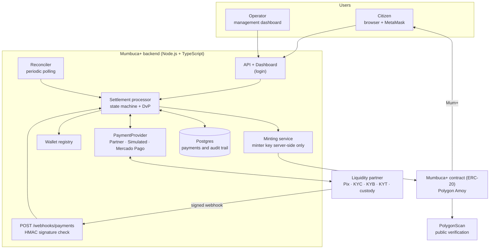
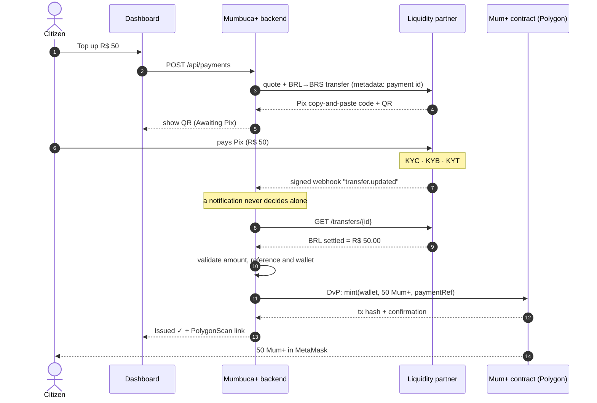
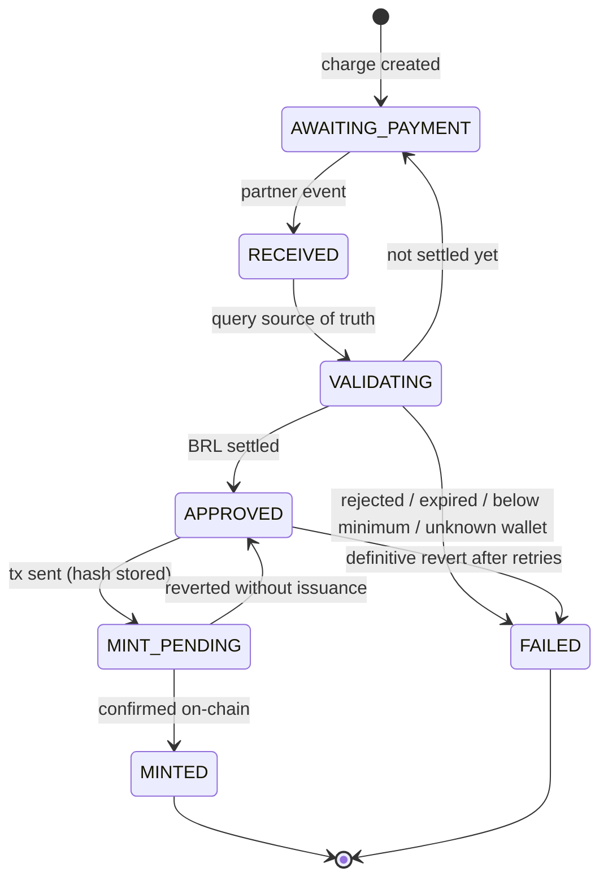

# Mumbuca+

[🇧🇷 Português](README.md) · 🇺🇸 English

**Tokenization infrastructure for social currencies: a payment in Brazilian reais, settled by a regulated partner, automatically becomes traceable digital balance in the citizen's wallet — with delivery conditioned on payment (DvP) and compliance by design.**

> Proof of concept for the **Mumbuca+** proposal, based on the report *"Renda Básica de Cidadania — Mumbuca"* (Faculdade Sebrae, Business Administration, class T9, Entrepreneurship & Social Impact, 2026). It is not an official system of the City of Maricá or of Banco Comunitário Mumbuca. It runs on the **Polygon Amoy** testnet.

---

## Contents

1. [The problem](#1-the-problem)
2. [What Mumbuca+ does](#2-what-mumbuca-does)
3. [The money route: BRL → BRS → Mumbuca+](#3-the-money-route-brl--brs--mumbuca)
4. [Liquidity and compliance partner](#4-liquidity-and-compliance-partner)
5. [Legal thesis: Mum+ is a utility token of the Maricá ecosystem](#5-legal-thesis-mum-is-a-utility-token-of-the-maricá-ecosystem)
6. [Financial-market principles applied](#6-financial-market-principles-applied)
7. [Compliance by design](#7-compliance-by-design)
8. [Architecture](#8-architecture)
9. [End-to-end flow](#9-end-to-end-flow)
10. [Web3 engineering and security](#10-web3-engineering-and-security)
11. [The Mumbuca+ token (Mum+)](#11-the-mumbuca-token-mum)
12. [How this strengthens the public policy](#12-how-this-strengthens-the-public-policy)
13. [Proof-of-concept scope](#13-proof-of-concept-scope)
14. [Repository layout and documentation](#14-repository-layout-and-documentation)
15. [References](#15-references)

---

## 1. The problem

Mumbuca is the social currency of Maricá, in the state of Rio de Janeiro, Brazil. It was created in 2013, is managed by Banco Comunitário Mumbuca (a community bank), is pegged 1:1 to the Brazilian real (1 Mumbuca = R$ 1.00) and funds the city's Basic Citizenship Income program. According to the report, in 2026 the program serves **more than 93,000 beneficiaries**, pays **230 Mumbucas per month** and moves an annual budget **above R$ 256 million**.

The report identifies bottlenecks that technology can address:

| Bottleneck (report) | How tokenization helps |
|---|---|
| Physical processes: plastic cards and thermal paper | 100% digital balances and receipts, verifiable on-chain |
| Manual traceability and accountability | Every issuance has a public hash anyone can audit |
| Closed payment arrangement, hard to integrate | Open standard (ERC-20) that plugs into wallets and payment institutions |
| Fiscal dependence on public transfers only | Funds entering through payment institutions enable top-ups and partnerships |

The report proposes a **tokenized dual wallet**. This repository builds its **technical foundation**: an automatic, auditable and compliant bridge between money entering through the payment system and the token reaching the citizen.

## 2. What Mumbuca+ does

1. The citizen picks an amount and makes a **top-up via Pix**, Brazil's instant payment system.
2. The **liquidity partner** receives the reais, with KYC, KYB and KYT applied at the entry point.
3. The Mumbuca+ backend **detects settlement**, through a signed webhook or periodic polling, and **confirms it directly against the partner's API**. A notification alone never triggers issuance.
4. Once the payment is settled, the backend calls `mint()` on the smart contract: **delivery versus payment (DvP)**.
5. **Mumbuca+ (Mum+) shows up in the citizen's MetaMask wallet**, 1 Mum+ for every R$ 1.00 settled.
6. The transaction is **public and verifiable** on PolygonScan.
7. No payment is ever minted twice, even with redeliveries, network failures or server restarts.

## 3. The money route: BRL → BRS → Mumbuca+


- **BRL:** the citizen pays in reais via Pix, the currency they already use.
- **BRS:** the liquidity partner converts the reais into **BRS**, a real-referenced token on Solana. The BRL→BRS conversion has **no foreign-exchange leg**: no quote against a foreign currency, no FX lock, and a 1:1 rate within the same monetary standard. The BRS is held in **segregated custody** and forms the **reserve in reais** backing issuance.
- **Mumbuca+:** once BRL settlement is confirmed, the system issues **Mum+ in the same amount in reais** to the citizen's wallet. Mum+ is the **social-currency layer**, where public-policy rules apply: territory, incentives for local commerce and controlled credit.

End to end, **value is always denominated in reais**: BRL, then BRS (tokenized real), then Mum+ (a social currency pegged to the real). **No leg involves a foreign currency.**

> **Environments:** the same BRL → BRS → Mumbuca+ route runs in the partner's test environment (simulated Pix) and in production (real Pix, minimum R$ 11). The reserve asset (BRS) is set by a single environment variable.

## 4. Liquidity and compliance partner

Mumbuca+ **does not hold money, convert currencies or process Pix itself**. Those functions sit with a **regulated liquidity partner**, integrated by Peragus, which already runs this integration in production. The partner provides:

- **Liquidity:** receiving Pix in reais and converting BRL→BRS.
- **Custody:** segregated custody of the reserve.
- **KYC** (*Know Your Customer*): identification and verification of individuals.
- **KYB** (*Know Your Business*): identification and verification of legal entities, including ultimate beneficial owners.
- **KYT** (*Know Your Transaction*): transaction monitoring and screening, tracing the source and destination of funds.
- **AML/CFT:** anti-money-laundering and counter-terrorist-financing controls, with sanctions and restricted-list screening.
- **Signed settlement events:** webhooks with HMAC-SHA256, plus a **query API** that serves as the source of truth.

| Responsibility | Performed by |
|---|---|
| Receive Pix and settle in reais | Liquidity partner |
| KYC, KYB, KYT, AML/CFT and sanctions | Liquidity partner |
| Convert BRL into BRS and hold the reserve | Liquidity partner |
| Notify settlement (signed webhook + query API) | Liquidity partner |
| Validate settlement, execute DvP and issue the social currency | Mumbuca+ |
| Public-policy rules (territory, incentives, credit) | Ecosystem governor (City and community bank) |

**Why this design:**
- **Segregation of duties:** the regulated financial activity stays with the party that holds the license, the infrastructure and the responsibility for it. Mumbuca+ owns the public-policy layer.
- **Provider-agnostic:** the issuance core only knows the `PaymentProvider` interface. The current partner, Mercado Pago (designed, not yet integrated) and a simulated provider are interchangeable adapters.
- **Reuse with controlled risk:** the integration comes from code Peragus already runs in production.

## 5. Legal thesis: Mum+ is a utility token of the Maricá ecosystem

### 5.1 The thesis

**Mumbuca+ (Mum+) is a utility token** of Maricá's social-currency ecosystem. It gives its holder access to products and services in the city's accredited network, under the rules of a public program. It therefore falls **outside the legal definition of "virtual asset"** in Brazilian Law 14,478/2022, and so outside the foreign-exchange rules that apply to virtual-asset service providers. **The token is governed by the ecosystem's own governor:** the City of Maricá, through municipal law, and Banco Comunitário Mumbuca, which operates the network.

### 5.2 Grounds

1. **The law expressly excludes utility tokens from the definition of virtual asset.**
   - Article 3 of Law 14,478/2022 defines a virtual asset as *"a digital representation of value that can be traded or transferred electronically and used for payments or for investment purposes"*.
   - Item III then excludes *"instruments that give their holder access to specified products or services, or to a benefit arising from them, such as points and rewards of loyalty programs"*.
2. **Mum+ is an instrument of access to a public-program benefit.**
   - It is accepted only within Maricá's accredited network.
   - It carries the program's rules: the 5% incentive for local commerce and the essential categories of external credit (health, transport, emergencies) set out in the report.
   - Like loyalty points, it has value within an ecosystem defined by whoever administers it.
3. **There is no investment purpose.**
   - The peg is fixed (1 Mum+ = R$ 1.00).
   - There is no yield, no appreciation, no public offering and no secondary market promoted by the issuer.
   - In Guidance Opinion 40/2022, the Brazilian Securities Commission (CVM) separates utility tokens from tokens that are securities by the absence of an expectation of profit from the efforts of others.
4. **No virtual asset means no virtual-asset FX.**
   - Article 76-A of Central Bank Resolution 277/2022, added by Resolution 521/2025, brings the *provision of virtual-asset services* into the foreign-exchange market.
   - Because Mum+ is not a virtual asset, its issuance and circulation fall outside that rule.
   - Moreover, no step of the route involves a foreign currency.
5. **The ecosystem's governor regulates the token.**
   - Mumbuca is a social currency established and governed by the City of Maricá (the report cites Municipal Law 3,673/2025) and operated by Banco Comunitário Mumbuca.
   - Merchant accreditation, usage rules, limits and issuance against incoming reais are that governor's decisions. Mumbuca+ simply carries those rules onto a token.
   - Social currencies have followed this model since Banco Palmas (1998): **backing in reais, 1:1 peg, territorial circulation and no legal-tender status**, as the Central Bank itself describes.
6. **Each layer has its own regulator.** The financial operation sits with the party regulated for it:

| Layer | Instrument | Nature | Regulated by / accountable |
|---|---|---|---|
| Entry | BRL via Pix | national currency | Central Bank (Pix) and the receiving institution (liquidity partner) |
| Reserve | BRS | real-referenced asset | Liquidity partner, under the virtual-asset service provider regime |
| Use | Mum+ | social-currency utility token | City of Maricá and Banco Comunitário Mumbuca |

### 5.3 How the technical design reinforces the thesis

- **DvP (Delivery versus Payment):** Mum+ is delivered only against confirmed settlement in reais. There is no pre-minting, pre-sale or public offering. Supply is created exclusively from payments settled and validated at the source.
- **Fixed peg, no price formation:** the system runs no order book, no quotes and no trading.
- **On-chain governance by the ecosystem governor:** the admin and pauser roles belong to the governor, who can suspend issuance and adjust limits.
- **Utility specified in code:** the next step is to restrict transfers in the contract to accredited wallets (network merchants and beneficiaries). That makes the "specified utility" of Article 3, item III verifiable on-chain.

### 5.4 Anticipated objections

- **"A real-pegged token accepted across a network is a means of payment."**
  - Mum+ circulates only within an accredited network defined by the public governor, as access to a program benefit. That is exactly the case covered by Article 3, item III.
  - Restricting transfers to accredited wallets makes that boundary verifiable on-chain.
- **"A city cannot issue currency."**
  - Mum+ is not currency. Issuing currency is a federal power (Federal Constitution, Art. 21, VII), and only the Union may legislate on the monetary system (Art. 22, VI).
  - Mum+ is an instrument of a municipal program **with no legal-tender status**: nobody is obliged to accept it.
- **"Buying BRS could be FX under Article 76-A, IV."**
  - The BRS is acquired by the liquidity partner, which provides the virtual-asset service and complies with its own regime.
  - That does not change the nature of Mum+, nor does it turn the Mumbuca+ ecosystem into an FX operation.

## 6. Financial-market principles applied

| Principle | How it appears in Mumbuca+ |
|---|---|
| **DvP (Delivery versus Payment)** | The asset (Mum+) is delivered only after the payment (BRL) settles, which removes principal risk: nobody receives tokens without having paid |
| **Settlement finality** | BRL counts as settled only on the partner's official status. Mum+ counts as delivered only after block confirmation |
| **1:1 backing and segregated reserve** | Each Mum+ corresponds to R$ 1.00 received, held as BRS in the partner's segregated custody |
| **Golden source** | The partner's API is the official source for the payment. The webhook only notifies and never decides |
| **Idempotency and exactly-once** | Each payment produces at most one issuance, guaranteed by the database and the contract (unique `paymentRef`) |
| **Continuous reconciliation** | A reconciler periodically compares local state with the partner and the chain, and resumes anything pending |
| **Audit trail** | Every state transition and every incoming event is recorded append-only, with the original payload |
| **Settlement state machine** | `AWAITING_PAYMENT → RECEIVED → VALIDATING → APPROVED → MINT_PENDING → MINTED` (or `FAILED`), with atomic transitions |
| **Minor units** | All amounts are handled as integer cents, with no floating point and no rounding errors |
| **Exposure limits** | Supply cap, per-issuance limit, and minimum and maximum amount per top-up |

## 7. Compliance by design

- **KYC, KYB and KYT at the door:** every real that enters passes through the liquidity partner's controls before any issuance exists.
- **AML/CFT:** the architecture follows Brazilian Law 9,613/1998.
  - The partner identifies the source of funds.
  - The destination is traceable on-chain.
  - The audit trail is complete, from the event to the hash.
- **Travel Rule (FATF Recommendation 16):** the link between payer, payment and destination wallet is recorded end to end.
- **LGPD (Brazil's data-protection law, 13,709/2018) and data minimization:**
  - The Mumbuca+ layer stores only what it needs: an identifier, the wallet, amounts and events.
  - Civil identification stays with the regulated partner.
  - The demo uses fictitious data only and no CadÚnico (Brazil's social-programs registry) data.
- **Segregation of duties and least privilege:**
  - The account that administers the contract is separate from the account that mints.
  - The minter can only mint.
  - The governor holds the admin and pauser roles.
- **Circuit breaker:** the emergency pause suspends new issuance without affecting balances.
- **Key management:** the minting key lives only on the server, in an environment variable. It is never in the browser or the repository.
- **Transparency for oversight bodies:**
  - Every issuance has a public hash verifiable on the explorer.
  - The operator dashboard shows each payment's origin, amounts, state and any discrepancies.

## 8. Architecture



| Module | Responsibility |
|---|---|
| ERC-20 contract | Controlled issuance, supply cap, pause, duplicate-issuance protection |
| PaymentProvider | Single interface for any payment institution or liquidity partner |
| Webhook handler | Receives events, verifies the signature, records them without trusting the payload |
| Validator | Queries the payment on the partner's official API and checks status, amount and reference |
| Wallet registry | Links each user (fictitious in the demo) to a validated Polygon address (EIP-55) |
| Minting service | Simulates, sends `mint`, tracks confirmation, recovers from failures without duplicating |
| Transaction database | Complete, auditable history of every payment and transition |
| Dashboard | Citizen view (balance, top-up, history) and operator view (all payments, hashes, actions) |

**Stack:**
- Contract: Solidity and OpenZeppelin v5.
- Deployment: Remix and MetaMask.
- Backend: Node.js 22, TypeScript, Fastify and Postgres.
- Blockchain client: viem.
- Dashboard: React and Vite.
- Hosting: Railway.

## 9. End-to-end flow



### Per-payment state machine



Transient failures do **not** lead to `FAILED`. These include network instability, timeouts and the partner being unavailable. The payment stays in its current state and the reconciler retries.

## 10. Web3 engineering and security

**Zero duplicate issuance, in four layers:**
1. Every partner event is recorded by its identifier, and repeats are discarded.
2. Every payment changes state through a conditional, atomic Postgres update. This is safe under concurrency between the webhook and the reconciler.
3. Before retrying an uncertain issuance, the backend asks the contract whether that payment was already minted, and recovers the hash from the on-chain event.
4. **In the contract itself:** `mint(to, amount, paymentRef)` rejects any repeated `paymentRef`. This final guarantee does not depend on the backend.

**On-chain engineering practices:**
- **Deterministic `paymentRef`:** `keccak256("<provider>:<payment id>")` ties each issuance uniquely and verifiably to the payment that originated it.
- **Role-based access control** with OpenZeppelin `AccessControl`: separate `DEFAULT_ADMIN_ROLE`, `MINTER_ROLE` and `PAUSER_ROLE`.
- **Custom errors** (`PaymentRefAlreadyUsed`, `MintAmountExceedsLimit`, `InvalidMintAmount`): cheaper in gas, and decoded by the backend to decide between retrying and failing.
- **Simulate before send:** every `mint` is simulated (`eth_call`) before broadcast, so a predictable revert never spends gas.
- **Failure classification:**
  - A decoded revert is definitive.
  - Network errors, timeouts and lack of gas are transient.
  - An unidentified revert is treated as definitive, to avoid infinite retry loops.
- **Indexed events** (`MintedForPayment`, with `paymentRef` indexed) for auditing and recovery.
- **EIP-55 checksummed addresses** in the wallet registry.
- **Verified contract** on the explorer, with public source code.
- **Testing:**
  - The contract is tested on a local EVM (Hardhat).
  - The backend is built test-first (vitest), including real integration tests against a local node.

**Further guarantees:**
- **Nothing is minted just because a notification arrived.** The payment is always confirmed at the source of truth.
- Webhooks are authenticated with HMAC-SHA256, a time window and constant-time comparison.
- The contract limits the damage from a leaked key: total cap, per-issuance limit and an emergency pause.
- The entire public URL is behind a login. Strangers cannot create top-ups or trigger issuance.

## 11. The Mumbuca+ token (Mum+)

| Property | Value |
|---|---|
| Nature | Utility token of Maricá's social-currency ecosystem (see section 5) |
| Standard | ERC-20 (OpenZeppelin v5) |
| Name / symbol | Mumbuca+ / Mum+ |
| Decimals | 18 |
| Initial supply | 0. Everything is issued against settled payment (DvP) |
| Supply cap | 10,000,000 Mum+ |
| Per-issuance limit | 20,000 Mum+ (adjustable by the admin) |
| Roles | Admin (governor), Minter (backend), Pauser (governor) |
| Pause | Suspends new issuance only. Balances and transfers keep working |
| Traceability | `MintedForPayment(wallet, amount, paymentRef)` event on every issuance |
| Network | Polygon Amoy (chain ID 80002). Contract deployed and verified through Remix |

**Peg:** 1 Mum+ = R$ 1.00.

## 12. How this strengthens the public policy

| Report objective | Mumbuca+ contribution |
|---|---|
| Modernization and digitalization | Social currency on an open standard, with no cards or paper |
| Traceability | Every real that enters produces a public, auditable issuance |
| Integration with payment institutions | Pluggable providers: Pix today, others tomorrow |
| Financial inclusion | Works with Pix and a digital wallet, without a traditional bank account |
| Operational sustainability | Less manual service and physical logistics. A base for own revenue such as top-ups and partnerships |
| Local economy | Mum+ is the layer for territory and incentive rules (5% for local commerce, controlled external credit; future modules in the report) |
| Transparency and oversight | Management dashboard plus a public explorer for oversight bodies |

## 13. Proof-of-concept scope

**In scope:**
- ERC-20 contract on Polygon Amoy.
- Pix top-up through the liquidity partner, in the test and production environments (R$ 11).
- Validation at the source of truth.
- Automatic, idempotent DvP.
- Citizen and operator dashboards.
- Local simulation as a fallback.

**Future phases:**
- Restricting transfers to accredited wallets.
- Dual wallet and the 5% incentive.
- 25% external credit.
- Own card terminals.
- AI assistant.
- Mercado Pago integration.
- Redemption of Mum+ into reais.
- On-chain proof of reserves.
- Mainnet.

**Status:** the design is approved and implementation is in progress. See the [design](docs/superpowers/specs/2026-11-23-mumbuca-plus-mvp-design.md) and the [implementation plan](docs/superpowers/plans/2026-11-23-mumbuca-plus-mvp.md). Both are in Portuguese.

## 14. Repository layout and documentation

```
contracts/     MumbucaPlus.sol contract and tests
backend/       API, webhook, processor, minting (Node.js + TypeScript)
frontend/      dashboard (React + Vite)
docs/
  superpowers/specs/   design document
  superpowers/plans/   implementation plan
  remix-deploy.md      Remix deployment guide
  demo-runbook.md      demo script and contingencies
```

Instructions for running locally and deploying will be added here once implementation is complete.

## 15. References

- Report *"Renda Básica de Cidadania — Mumbuca"*. Faculdade Sebrae, 2026. Includes the FGV, UFF, Banco Mumbuca, CODEMAR and City of Maricá sources it cites.
- Brazil. **Federal Constitution**, Art. 21, VII and Art. 22, VI (federal power over currency and the monetary system).
- Brazil. **Law 14,478/2022**, the legal framework for virtual-asset service providers. Art. 3 defines virtual assets and their exclusions. [planalto.gov.br](https://www.planalto.gov.br/ccivil_03/_ato2019-2022/2022/lei/l14478.htm)
- Brazil. **Law 12,865/2013**, payment arrangements and payment institutions.
- Brazil. **Law 9,613/1998**, anti-money laundering.
- Brazil. **Law 13,709/2018** (LGPD), personal data protection.
- Central Bank of Brazil. **Resolutions 519, 520 and 521/2025**, covering virtual-asset service providers and the inclusion of virtual-asset operations in the foreign-exchange market (Art. 76-A of Resolution 277/2022). [Resolution 521 text](https://www.bcb.gov.br/estabilidadefinanceira/exibenormativo?tipo=Resolu%C3%A7%C3%A3o%20BCB&numero=521)
- Brazilian Securities Commission (CVM). **Guidance Opinion 40/2022**, crypto-assets and the securities market.
- FATF. **Recommendation 16** (Travel Rule) and guidance on virtual assets and VASPs.
- Central Bank of Brazil. Presentation on social currencies and community banks. [bcb.gov.br](https://www.bcb.gov.br/pre/microFinancas/arquivos/horario_arquivos/apres_62.pdf)
- Revista Pesquisa FAPESP. *Bancos comunitários impulsionam o desenvolvimento local*. [revistapesquisa.fapesp.br](https://revistapesquisa.fapesp.br/bancos-comunitarios-impulsionam-o-desenvolvimento-local/)
- OpenZeppelin Contracts v5: [docs.openzeppelin.com/contracts/5.x](https://docs.openzeppelin.com/contracts/5.x/)
- Polygon Amoy: [amoy.polygonscan.com](https://amoy.polygonscan.com)

---

*Mumbuca+ is a public-policy modernization proposal. The tokens in this demo circulate on a testnet only.*
