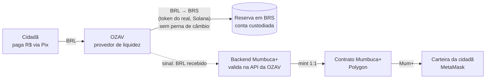
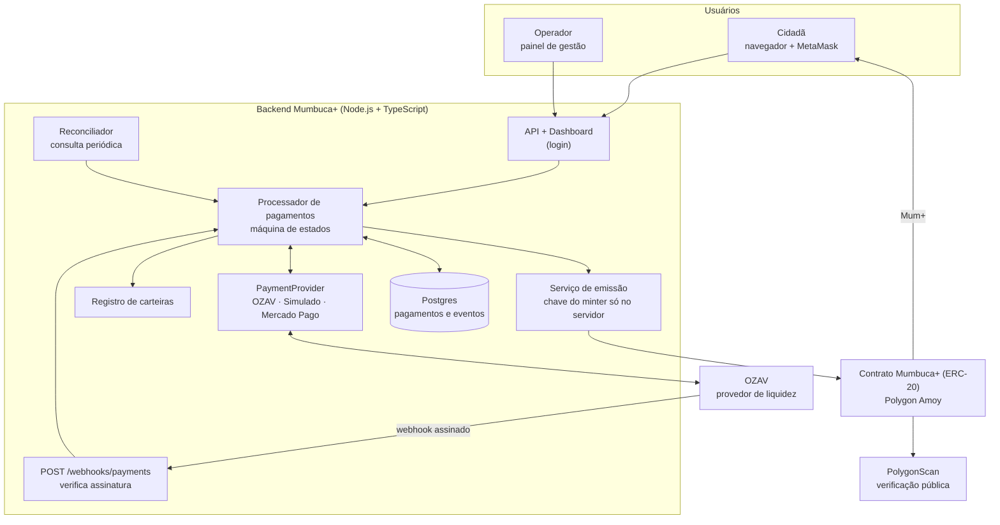
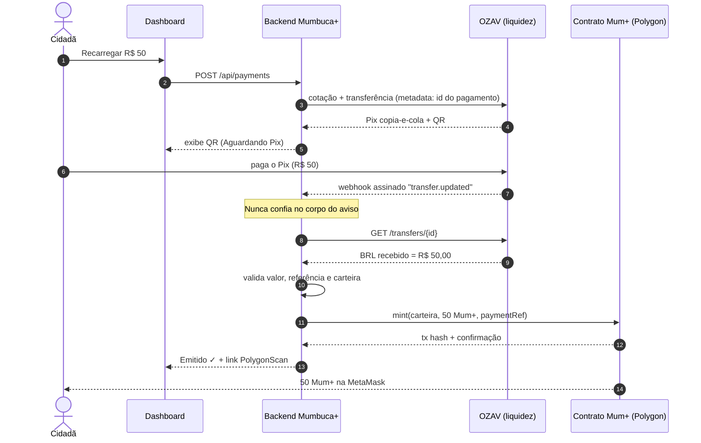
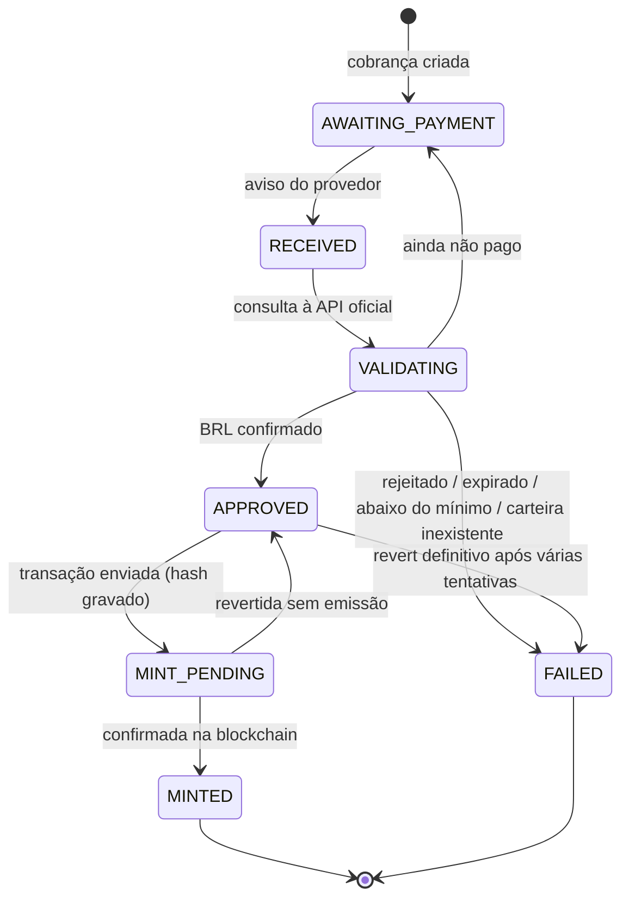

# Mumbuca+

**Infraestrutura de tokenização para moedas sociais: um pagamento em reais confirmado por uma instituição de pagamento vira, automaticamente, saldo digital rastreável na carteira do cidadão.**

> Prova de conceito acadêmica da proposta **Mumbuca+**, desenvolvida a partir do relatório *"Renda Básica de Cidadania — Mumbuca"* (Faculdade Sebrae, Administração de Empresas, Turma T9, disciplina Empreendedorismo & Impacto Social, 2026). Não é um sistema oficial da Prefeitura de Maricá nem do Banco Comunitário Mumbuca. Roda na rede de testes **Polygon Amoy**.

---

## Sumário

1. [O problema](#1-o-problema)
2. [O que o Mumbuca+ faz](#2-o-que-o-mumbuca-faz)
3. [A rota do dinheiro: BRL → BRS → Mumbuca+](#3-a-rota-do-dinheiro-brl--brs--mumbuca)
4. [Provedor de liquidez](#4-provedor-de-liquidez)
5. [Tese jurídica: o Mum+ é um utility token do ecossistema de Maricá](#5-tese-jurídica-o-m-é-um-utility-token-do-ecossistema-de-maricá)
6. [Arquitetura](#6-arquitetura)
7. [Fluxo ponta a ponta](#7-fluxo-ponta-a-ponta)
8. [Segurança e garantias](#8-segurança-e-garantias)
9. [O token Mumbuca+ (Mum+)](#9-o-token-mumbuca-m)
10. [Como isso fortalece a política pública](#10-como-isso-fortalece-a-política-pública)
11. [Escopo da prova de conceito](#11-escopo-da-prova-de-conceito)
12. [Estrutura do repositório e documentação](#12-estrutura-do-repositório-e-documentação)
13. [Referências](#13-referências)

---

## 1. O problema

A Mumbuca é a moeda social de Maricá (RJ). Criada em 2013 e gerida pelo Banco Comunitário Mumbuca, ela tem paridade fixa com o real (1 Mumbuca = R$ 1,00) e sustenta a Renda Básica de Cidadania do município. Segundo o relatório, em 2026 o programa atende **mais de 93 mil beneficiários**, paga **230 Mumbucas por mês** e movimenta um orçamento anual **acima de R$ 256 milhões**.

O relatório aponta gargalos que a tecnologia pode atacar:

| Gargalo (relatório) | Como a tokenização ajuda |
|---|---|
| Processos físicos: cartões plásticos e papel térmico | Saldo e comprovante 100% digitais, verificáveis on-chain |
| Rastreabilidade e prestação de contas manuais | Cada emissão tem um hash público e auditável por qualquer pessoa |
| Dependência de um arranjo fechado, difícil de integrar | Padrão aberto (ERC-20) integrável a qualquer carteira e instituição de pagamento |
| Dependência fiscal exclusiva de repasses públicos | Entrada de recursos por instituições de pagamento abre caminho a novas fontes, como recargas e parcerias |

O relatório propõe uma **carteira dupla tokenizada**. Este repositório constrói a **fundação técnica** dessa carteira: a ponte automática e segura entre o dinheiro que entra pelo sistema de pagamentos e o token que chega ao cidadão.

## 2. O que o Mumbuca+ faz

1. A cidadã escolhe um valor e faz uma **recarga via Pix**.
2. O **provedor de liquidez** (OZAV) recebe os reais.
3. O backend do Mumbuca+ **detecta a chegada do dinheiro** por webhook ou por consulta periódica, e **confirma direto na API do provedor**. Nunca confia apenas na notificação.
4. O backend executa `mint()` no contrato inteligente.
5. Os **Mumbuca+ (Mum+) aparecem na carteira MetaMask** da cidadã, 1 Mum+ para cada R$ 1,00 recebido.
6. A transação fica **pública e verificável** na PolygonScan.
7. Nenhum pagamento gera emissão duplicada, mesmo com reenvios, quedas de rede ou reinícios do servidor.

## 3. A rota do dinheiro: BRL → BRS → Mumbuca+



- **BRL:** o cidadão paga em reais, pelo Pix, a moeda que ele já usa.
- **BRS:** o provedor de liquidez converte os reais em **BRS**, um token referenciado no real que roda na Solana e é oferecido pela OZAV. A conversão BRL→BRS **não tem perna de câmbio**: não há cotação contra moeda estrangeira nem trava de câmbio, e a taxa é 1:1 no mesmo padrão monetário. O BRS fica numa carteira custodiada e serve de **reserva em reais** da operação.
- **Mumbuca+:** com a chegada do BRL confirmada, o sistema emite **Mum+ na mesma quantidade em reais** na carteira do cidadão. O Mum+ é a camada de **moeda social**: é nela que entram as regras da política pública, como o território, o incentivo ao comércio local e o crédito controlado previsto no relatório.

Do começo ao fim, **o valor está sempre denominado em reais**: BRL, depois BRS (real tokenizado) e por fim Mum+ (moeda social com paridade com o real). Nenhuma perna envolve moeda estrangeira.

> **Ambientes:** a mesma rota BRL → BRS → Mumbuca+ roda no sandbox da OZAV (Pix simulado, valores entre R$ 1.000 e R$ 10.000) e no ambiente real (Pix de verdade, mínimo de R$ 11). O ativo de destino é configurado por uma única variável (`OZAV_TARGET_CURRENCY=BRS`).

## 4. Provedor de liquidez

O Mumbuca+ **não guarda dinheiro, não converte moedas e não faz o Pix**. Essas funções ficam com um **provedor de liquidez** especializado. Na prova de conceito é a **OZAV**, usada por meio da integração que a **Peragus** já mantém em produção.

| Responsabilidade | Quem cumpre |
|---|---|
| Receber o Pix em reais | Provedor de liquidez (OZAV) |
| KYC, PLD/FT e compliance da conta que recebe | Provedor de liquidez (OZAV), sobre a conta da Peragus |
| Converter BRL em BRS e custodiar a reserva | Provedor de liquidez (OZAV) |
| Avisar a chegada do dinheiro (webhook assinado + API de consulta) | Provedor de liquidez (OZAV) |
| Validar o pagamento, decidir e emitir a moeda social | Mumbuca+ |
| Regras da política pública (território, incentivo, crédito) | Mumbuca+ / gestor público |

**Por que esse desenho:**
- **Separação de funções:** a parte financeira regulada fica com quem já opera e responde por ela. O Mumbuca+ fica com a camada de política pública.
- **Troca de provedor sem reescrever o sistema:** o núcleo de emissão só conhece a interface `PaymentProvider`. A OZAV, o Mercado Pago (desenhado, ainda sem integração) e um provedor simulado são adaptadores.
- **Reaproveitamento:** a integração com a OZAV vem de código já usado pela Peragus, o que reduz risco e prazo.

Detalhes técnicos: [`docs/providers/ozav.md`](docs/providers/ozav.md) (criado durante a implementação).

## 5. Tese jurídica: o Mum+ é um utility token do ecossistema de Maricá

> ⚠️ **Esta seção apresenta uma tese em construção, não um parecer jurídico.** Ela precisa ser validada por advogado especializado em regulação financeira e em direito administrativo municipal antes de qualquer uso fora do ambiente de testes.

### 5.1 A tese em uma frase

O **Mumbuca+ (Mum+) é um token de utilidade (utility token)** do ecossistema da moeda social de Maricá. Ele dá ao titular acesso a produtos e serviços da rede credenciada do município, dentro das regras de um programa público. Por isso fica **fora do conceito legal de "ativo virtual"** da Lei nº 14.478/2022 e, consequentemente, fora das regras de câmbio para prestadores de serviços de ativos virtuais do Banco Central. **Quem regula o uso desse token é o gestor do próprio ecossistema:** o Município de Maricá, por lei municipal, e o Banco Comunitário Mumbuca, que administra a rede.

### 5.2 Fundamentos

1. **A lei exclui expressamente os tokens de utilidade do conceito de ativo virtual.** O art. 3º da Lei nº 14.478/2022 define ativo virtual como *"a representação digital de valor que pode ser negociada ou transferida por meios eletrônicos e utilizada para realização de pagamentos ou com propósito de investimento"*. Em seguida exclui, no inciso III, os *"instrumentos que provejam ao seu titular acesso a produtos ou serviços especificados ou a benefício proveniente desses produtos ou serviços, a exemplo de pontos e recompensas de programas de fidelidade"*.
2. **O Mum+ é instrumento de acesso a um benefício de programa público.** Ele só é aceito na rede credenciada de Maricá e carrega as regras da política pública: o incentivo de 5% no comércio local e as categorias essenciais do crédito externo (saúde, transporte e emergência), previstos no relatório. Assim como os pontos de um programa de fidelidade, ele vale dentro de um ecossistema definido por quem o administra.
3. **Não há propósito de investimento.** A paridade é fixa (1 Mum+ = R$ 1,00) e não há rendimento, valorização, venda pública nem mercado secundário promovido pelo emissor. A CVM, no Parecer de Orientação nº 40/2022, separa os tokens de utilidade dos tokens que são valores mobiliários pela ausência de expectativa de retorno sobre o esforço de terceiros.
4. **Sem "ativo virtual", não há câmbio de ativo virtual.** O art. 76-A da Resolução BCB nº 277/2022 (incluído pela Resolução BCB nº 521/2025) leva ao mercado de câmbio a *prestação de serviços de ativos virtuais*. Se o Mum+ não é ativo virtual, a emissão e a circulação dele não entram nessa regra. Além disso, nenhuma etapa envolve moeda estrangeira.
5. **Quem regula o token é o gestor do ecossistema.** A Mumbuca é uma moeda social instituída e disciplinada pelo Município de Maricá (o relatório cita a Lei Municipal nº 3.673/2025) e operada pelo Banco Comunitário Mumbuca. O credenciamento de lojistas, as regras de uso, os limites e a emissão contra entrada de reais são decisões desse gestor. O Mumbuca+ só leva essas regras para um token. Moedas sociais seguem esse modelo desde o Banco Palmas (1998): **lastro em reais, paridade 1:1, circulação territorial e ausência de curso forçado**, como descreve material do próprio Banco Central.
6. **Cada camada tem o seu regulador.** A operação financeira fica com quem é regulado para ela:

| Camada | Instrumento | Natureza | Quem regula / responde |
|---|---|---|---|
| Entrada | BRL via Pix | moeda nacional | Banco Central (Pix) e a instituição recebedora (provedor de liquidez) |
| Reserva | BRS | ativo referenciado no real | Provedor de liquidez (OZAV), no regime de prestadores de serviços de ativos virtuais |
| Uso | Mum+ | utility token da moeda social | Município de Maricá e Banco Comunitário Mumbuca |

### 5.3 Como o desenho técnico reforça a tese

- **Emissão só contra entrada confirmada:** o supply nasce de reais recebidos, sem pré-venda nem oferta pública.
- **Paridade fixa e sem preço:** não há livro de ofertas, cotação nem negociação pelo sistema.
- **Governança on-chain do gestor:** os papéis de administrador e pausador ficam com o gestor do ecossistema, que pode suspender emissões e ajustar limites.
- **Próximo passo natural:** restringir no contrato as transferências a carteiras credenciadas (lojistas e beneficiários da rede). Isso materializa no código a "utilidade especificada" do art. 3º, III.

### 5.4 Pontos de atenção

- **"Produtos ou serviços especificados".** Um token aceito em qualquer comércio credenciado, com paridade em real, pode ser lido como **meio de pagamento**. Nessa leitura ele seria tratado como ativo virtual ou como instrumento de arranjo de pagamento (Lei nº 12.865/2013). A tese fica mais forte quanto mais fechada e definida for a rede e quanto menos o Mum+ circular fora dela.
- **Competência da União sobre moeda.** Emitir moeda é competência da União (CF, art. 21, VII), e legislar sobre sistema monetário é privativo dela (CF, art. 22, VI). Por isso a tese trata o Mum+ como **instrumento de um programa municipal, sem curso forçado**, e nunca como moeda.
- **A perna BRL→BRS.** O inciso IV do art. 76-A alcança, na literalidade, a *"compra, venda ou troca de ativos virtuais referenciados em moeda fiduciária"*. Se a aquisição de BRS for enquadrada aí, as obrigações são do provedor de liquidez, que é quem presta esse serviço, e não do ecossistema Mumbuca+.

### 5.5 Perguntas para a validação jurídica

1. O Mum+, com uso restrito à rede credenciada de Maricá e regras de programa público, se enquadra na exclusão do art. 3º, III, da Lei nº 14.478/2022?
2. Que características (rede fechada, restrição de transferência, ausência de resgate livre) tornam essa exclusão mais segura?
3. A lei municipal da Mumbuca dá base para o Município e o Banco Comunitário serem os gestores e reguladores do token, ou é preciso uma norma municipal específica para a versão tokenizada?
4. Qual entidade deve ser a emissora formal do Mum+ numa operação real, e qual é a relação dela com o provedor de liquidez?
5. Quais obrigações de PLD/FT e LGPD ficam com o gestor do ecossistema, considerando que o KYC da entrada é feito pelo provedor de liquidez?

## 6. Arquitetura



| Módulo | Responsabilidade |
|---|---|
| Contrato ERC-20 | Emissão controlada, teto de supply, pausa, bloqueio de emissão duplicada |
| PaymentProvider | Interface única para qualquer instituição de pagamento |
| Webhook Handler | Recebe avisos, verifica assinatura e registra sem confiar no conteúdo |
| Validador | Consulta o pagamento na API oficial do provedor e confere status, valor e referência |
| Registro de carteiras | Liga cada usuário (fictício na demo) a um endereço Polygon |
| Serviço de emissão | Envia `mint`, acompanha a confirmação e recupera falhas sem duplicar |
| Banco de transações | Histórico completo e auditável de cada pagamento e transição |
| Dashboard | Visão da cidadã (saldo, recarga, histórico) e do operador (todos os pagamentos, hashes, ações) |

**Tecnologias:** Solidity e OpenZeppelin (contrato), Remix e MetaMask (implantação), Node.js 22, TypeScript, Fastify e Postgres (backend), viem (blockchain), React e Vite (dashboard), Railway (hospedagem).

## 7. Fluxo ponta a ponta



### Máquina de estados de cada pagamento



Falhas temporárias, como instabilidade de rede, timeout ou provedor fora do ar, **não** levam a `FAILED`: o pagamento fica no estado em que está e o reconciliador tenta de novo.

## 8. Segurança e garantias

**Zero emissão duplicada, em quatro camadas:**
1. Cada aviso do provedor é registrado pelo seu identificador e o repetido é descartado.
2. Cada pagamento muda de estado com atualização condicional no banco, o que impede dois processamentos simultâneos.
3. Antes de reenviar uma emissão incerta, o backend pergunta ao contrato se aquele pagamento já foi emitido.
4. **No próprio contrato:** `mint(to, amount, paymentRef)` recusa qualquer `paymentRef` repetido. Essa garantia final não depende do backend.

**Outras garantias:**
- **Nada é emitido só porque chegou uma notificação.** O pagamento sempre é confirmado na API oficial do provedor.
- O webhook é autenticado por assinatura HMAC-SHA256 com janela de tempo.
- **A chave privada de emissão fica só no servidor**, nunca no navegador nem no repositório. A conta que administra o contrato é separada da conta que emite.
- O contrato limita o dano de uma eventual chave vazada: teto total, limite por emissão e pausa de emergência.
- Todos os valores são tratados em **centavos inteiros**, sem erros de arredondamento.
- Toda a URL pública fica atrás de login. Desconhecidos não criam recargas nem disparam emissões.
- Na demonstração não há nenhum dado real de beneficiário nem do CadÚnico.

## 9. O token Mumbuca+ (Mum+)

| Propriedade | Valor |
|---|---|
| Natureza | Utility token do ecossistema da moeda social de Maricá (ver seção 5) |
| Padrão | ERC-20 (OpenZeppelin v5) |
| Nome / símbolo | Mumbuca+ / Mum+ |
| Decimais | 18 |
| Supply inicial | 0. Tudo é emitido contra pagamento confirmado |
| Teto de supply | 10.000.000 Mum+ |
| Limite por emissão | 20.000 Mum+ (ajustável pelo administrador) |
| Papéis | Administrador (gestor), Emissor (backend), Pausador (gestor) |
| Pausa | Suspende só novas emissões. Os saldos e as transferências continuam |
| Rastreabilidade | Evento `MintedForPayment(carteira, valor, paymentRef)` em cada emissão |
| Rede | Polygon Amoy (chain ID 80002). O contrato é implantado e verificado pelo Remix |

**Paridade experimental:** 1 Mum+ = R$ 1,00, só nesta demonstração. Na prova de conceito não há resgate nem conversibilidade garantida.

## 10. Como isso fortalece a política pública

| Objetivo do relatório | Contribuição do Mumbuca+ |
|---|---|
| Modernização e digitalização | Moeda social em padrão aberto, sem cartão nem papel |
| Rastreabilidade | Cada real que entra gera uma emissão pública e auditável |
| Integração com instituições de pagamento | Provedores plugáveis: Pix hoje, outros amanhã |
| Inclusão financeira | Funciona com Pix e carteira digital, sem conta bancária tradicional |
| Sustentabilidade operacional | Menos atendimento manual e logística física. Base para receitas próprias, como recargas e parcerias |
| Economia local | O Mum+ é a camada onde entram as regras de território e incentivo (5% no comércio local e crédito externo controlado, módulos futuros do relatório) |
| Transparência e controle | Painel de gestão e explorador público para órgãos de controle |

## 11. Escopo da prova de conceito

**Está no escopo:**
- Contrato ERC-20 na Polygon Amoy.
- Recarga Pix pela OZAV, nos ambientes sandbox e real (R$ 11).
- Validação na API do provedor.
- Emissão automática e idempotente.
- Dashboard da cidadã e do operador.
- Simulação local para contingência.

**Fica para fases futuras:**
- Carteira dupla e incentivo de 5%.
- Crédito externo de 25%.
- Maquininhas próprias.
- Assistente de IA.
- Integração real com o Mercado Pago.
- Resgate de Mum+ em reais.
- Rede principal (mainnet).
- Integração com o CadÚnico.

**Status:** o design está aprovado e a implementação está em andamento. Veja o [design](docs/superpowers/specs/2026-11-23-mumbuca-plus-mvp-design.md) e o [plano de implementação](docs/superpowers/plans/2026-11-23-mumbuca-plus-mvp.md).

## 12. Estrutura do repositório e documentação

```
contracts/     contrato MumbucaPlus.sol e testes
backend/       API, webhook, processador, emissão (Node.js + TypeScript)
frontend/      dashboard (React + Vite)
docs/
  superpowers/specs/   documento de design
  superpowers/plans/   plano de implementação
  remix-deploy.md      tutorial de implantação pelo Remix
  providers/           OZAV e Mercado Pago
  demo-runbook.md      roteiro da demonstração e contingências
```

Instruções para rodar localmente e para implantar serão adicionadas aqui quando a implementação terminar.

## 13. Referências

- Relatório *"Renda Básica de Cidadania — Mumbuca"*. Faculdade Sebrae, 2026. Inclui as fontes FGV, UFF, Banco Mumbuca, CODEMAR e Prefeitura de Maricá citadas nele.
- Brasil. **Lei nº 14.478/2022**, marco legal dos prestadores de serviços de ativos virtuais. Art. 3º: definição de ativo virtual e exclusões. [planalto.gov.br](https://www.planalto.gov.br/ccivil_03/_ato2019-2022/2022/lei/l14478.htm)
- Brasil. **Constituição Federal**, arts. 21, VII, e 22, VI (competência da União sobre moeda e sistema monetário).
- Brasil. **Lei nº 12.865/2013**, arranjos e instituições de pagamento.
- Comissão de Valores Mobiliários. **Parecer de Orientação nº 40/2022**, criptoativos e o mercado de valores mobiliários (taxonomia de tokens de pagamento, de utilidade e referenciados a ativos).
- Banco Central do Brasil. **Resoluções BCB nº 519, 520 e 521/2025**, sobre prestadores de serviços de ativos virtuais e a inclusão de operações com ativos virtuais no mercado de câmbio (art. 76-A da Resolução BCB nº 277/2022). [Texto da Resolução BCB nº 521](https://www.bcb.gov.br/estabilidadefinanceira/exibenormativo?tipo=Resolu%C3%A7%C3%A3o%20BCB&numero=521)
- Banco Central do Brasil. Apresentação sobre moedas sociais e bancos comunitários (microfinanças). [bcb.gov.br](https://www.bcb.gov.br/pre/microFinancas/arquivos/horario_arquivos/apres_62.pdf)
- Revista Pesquisa FAPESP. *Bancos comunitários impulsionam o desenvolvimento local*. [revistapesquisa.fapesp.br](https://revistapesquisa.fapesp.br/bancos-comunitarios-impulsionam-o-desenvolvimento-local/)
- Barbieri Advogados. *O paradoxo das stablecoins: quando o real digital encontra o IOF*. Leitura do art. 76-A, IV, aplicada a stablecoins em real. [barbieriadvogados.com](https://www.barbieriadvogados.com/o-paradoxo-das-stablecoins-quando-o-real-digital-encontra-o-iof/)
- OpenZeppelin Contracts v5: [docs.openzeppelin.com/contracts/5.x](https://docs.openzeppelin.com/contracts/5.x/)
- Polygon Amoy: [amoy.polygonscan.com](https://amoy.polygonscan.com)

---

*Mumbuca+ é uma proposta acadêmica de modernização de política pública. Os tokens desta demonstração circulam apenas em rede de testes.*
