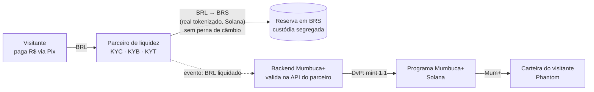
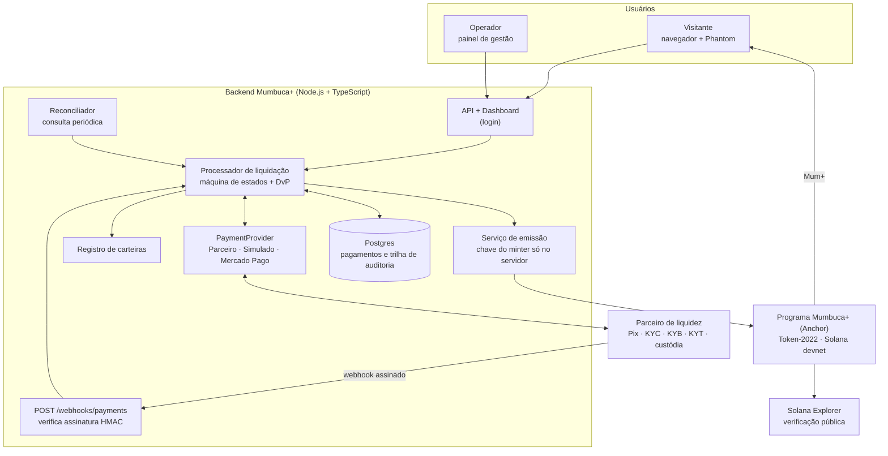
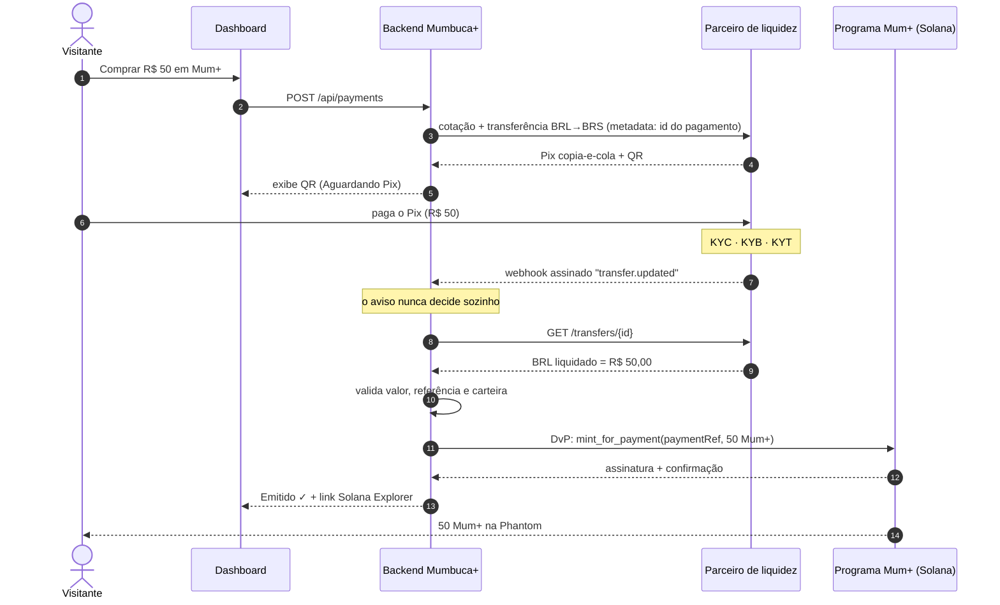
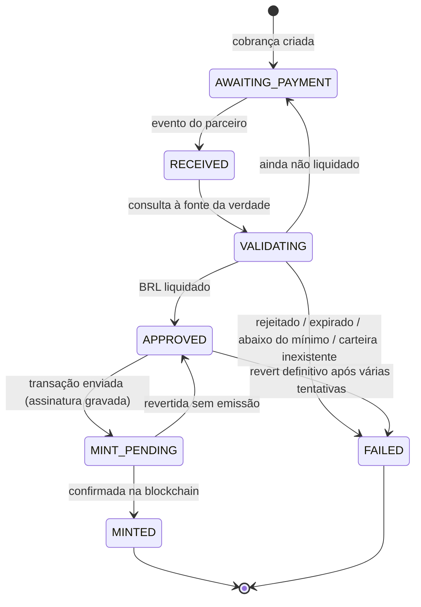

# Mumbuca+

🇧🇷 Português · [🇺🇸 English](README.en.md)

**Infraestrutura de tokenização para moedas sociais: um pagamento em reais, liquidado por um parceiro regulado, vira automaticamente Mum+ na carteira do visitante, para gastar em Maricá com benefícios e descontos, com entrega condicionada ao pagamento (DvP) e compliance desde o desenho. Na proposta, parte do lucro da operação financia cinema e cultura na cidade.**

> Prova de conceito da proposta **Mumbuca+**, desenvolvida a partir do relatório *"Renda Básica de Cidadania — Mumbuca"* (Faculdade Sebrae, Administração de Empresas, Turma T9, disciplina Empreendedorismo & Impacto Social, 2026). Não é um sistema oficial da Prefeitura de Maricá nem do Banco Comunitário Mumbuca. Roda na **Solana devnet**.

---

## Sumário

1. [O problema](#1-o-problema)
2. [O que o Mumbuca+ faz](#2-o-que-o-mumbuca-faz)
3. [A rota do dinheiro: BRL → BRS → Mumbuca+](#3-a-rota-do-dinheiro-brl--brs--mumbuca)
4. [Parceiro de liquidez e compliance](#4-parceiro-de-liquidez-e-compliance)
5. [Tese jurídica: o Mum+ é um utility token do ecossistema de Maricá](#5-tese-jurídica-o-mum-é-um-utility-token-do-ecossistema-de-maricá)
6. [Fundamentos de mercado financeiro aplicados](#6-fundamentos-de-mercado-financeiro-aplicados)
7. [Compliance by design](#7-compliance-by-design)
8. [Arquitetura](#8-arquitetura)
9. [Fluxo ponta a ponta](#9-fluxo-ponta-a-ponta)
10. [Engenharia web3 e segurança](#10-engenharia-web3-e-segurança)
11. [O contrato inteligente e o token Mum+](#11-o-contrato-inteligente-e-o-token-mum)
12. [Como isso fortalece a política pública](#12-como-isso-fortalece-a-política-pública)
13. [Escopo da prova de conceito](#13-escopo-da-prova-de-conceito)
14. [Estrutura do repositório e documentação](#14-estrutura-do-repositório-e-documentação)
15. [Referências](#15-referências)

---

## 1. O problema

A Mumbuca é a moeda social de Maricá (RJ). Criada em 2013 e gerida pelo Banco Comunitário Mumbuca, ela tem paridade fixa com o real (1 Mumbuca = R$ 1,00) e sustenta a Renda Básica de Cidadania do município. Segundo o relatório, em 2026 o programa atende **mais de 93 mil beneficiários**, paga **230 Mumbucas por mês** e movimenta um orçamento anual **acima de R$ 256 milhões**.

Hoje a Mumbuca circula num arranjo fechado, voltado a quem recebe o benefício. O **Mumbuca+** abre a moeda social para o **público externo**. Turistas e visitantes compram Mum+ via Pix para gastar na rede credenciada de Maricá, com acesso a **benefícios e descontos**. Com isso, o dinheiro de fora entra direto no comércio local. Na proposta, **parte do lucro** da operação é revertida para **cinema e cultura** na cidade.

O relatório aponta gargalos que a tecnologia pode atacar:

| Gargalo (relatório) | Como a tokenização ajuda |
|---|---|
| Processos físicos: cartões plásticos e papel térmico | Saldo e comprovante 100% digitais, verificáveis on-chain |
| Rastreabilidade e prestação de contas manuais | Cada emissão tem uma assinatura pública, auditável por qualquer pessoa |
| Arranjo fechado, difícil de integrar | Padrão aberto (SPL Token-2022), integrável a carteiras e instituições de pagamento |
| Dependência fiscal exclusiva de repasses públicos | A venda de Mum+ a visitantes traz recursos de fora para a economia local e gera receita própria, parte dela destinada à cultura |
| Moeda restrita a residentes e beneficiários | Visitantes compram Mum+ via Pix e usam na mesma rede credenciada, com benefícios e descontos |

O relatório propõe uma **carteira dupla tokenizada**. Este repositório constrói a **fundação técnica** dessa carteira: a ponte automática, auditável e em conformidade entre o dinheiro que entra pelo sistema de pagamentos e o token que chega à carteira de quem vai gastar em Maricá.

## 2. O que o Mumbuca+ faz

**Para quem:** visitantes e turistas que vão a Maricá. Eles compram Mum+ e ganham **benefícios e descontos** na rede credenciada da cidade, nas categorias:
- gastronomia;
- hospedagem;
- cultura e cinema;
- comércio local, com cashback de 5% nas compras.

Cada compra também apoia a cultura local. Na prova de conceito, os benefícios exibidos no app são **ilustrativos**.

1. O visitante escolhe um valor e **compra Mum+ via Pix**.
2. O **parceiro de liquidez** recebe os reais, já com KYC, KYB e KYT aplicados na entrada.
3. O backend do Mumbuca+ **detecta a liquidação** por webhook assinado ou por consulta periódica e **confirma direto na API do parceiro**. Uma notificação sozinha nunca dispara emissão.
4. Com o pagamento liquidado, o backend executa `mint_for_payment` no programa Solana: **entrega contra pagamento (DvP)**.
5. Os **Mumbuca+ (Mum+) aparecem na carteira Phantom** do visitante, 1 Mum+ para cada R$ 1,00 liquidado.
6. A transação fica **pública e verificável** no Solana Explorer.
7. Nenhum pagamento gera emissão duplicada, mesmo com reenvios, quedas de rede ou reinícios do servidor.
8. Com Mum+, o visitante gasta na rede credenciada de Maricá e aproveita os benefícios e descontos do programa.

**Na demonstração pública,** o visitante entra com a carteira Phantom e cria a conta com um nome de exibição. O Pix dos passos 2 e 3 é simulado pelo próprio backend, com o botão "Pagar agora (demonstração)". A emissão do passo 4 é real: o contrato inteligente na Solana devnet emite os Mum+ na carteira do visitante (ver seção 11). A integração com o parceiro de liquidez está pronta e usa o mesmo caminho, trocando só o provedor.

### Teste você mesmo

Site: https://mumbuca-plus-production.up.railway.app

1. Na Phantom, ative a Devnet: Settings → Developer settings → Testnet mode → Solana Devnet.
2. No site, clique em **Entrar com Phantom**. Você assina uma mensagem. Nenhuma transação é autorizada.
3. Clique em **Criar conta** e escolha um nome de exibição.
4. Clique em **＋ Comprar Mum+**, escolha um valor e clique em **Gerar Pix**.
5. Clique em **Pagar agora (demonstração)**.
6. Os Mum+ aparecem na Phantom (Devnet) e no Solana Explorer.

Nenhum dinheiro real é usado; tudo roda na Solana devnet. O contrato e o token podem ser conferidos no Solana Explorer: [programa](https://explorer.solana.com/address/HfFamsTJgSXssGkCgBqtNsDLD694peLYBbAzs4kuYzZm?cluster=devnet) e [token Mum+](https://explorer.solana.com/address/8kHEAtmxYof8GCw2LhoKLLg5DmJGaR1qkuBH2qdMSBuk?cluster=devnet).

Limites: de R$ 11 a R$ 100 por compra, 3 compras por carteira a cada 24 h, 1 compra pendente por vez e R$ 2.000 no total de todos os visitantes a cada 24 h. Uma compra não paga expira em 30 minutos. As compras podem ser pausadas automaticamente (por exemplo, quando o total do dia é atingido).

## 3. A rota do dinheiro: BRL → BRS → Mumbuca+



- **BRL:** o visitante paga em reais, pelo Pix, a moeda que ele já usa.
- **BRS:** o parceiro de liquidez converte os reais em **BRS**, um token referenciado no real que roda na Solana. A conversão BRL→BRS **não tem perna de câmbio**: não há cotação contra moeda estrangeira nem trava de câmbio, e a taxa é 1:1 no mesmo padrão monetário. O BRS fica em **custódia segregada** e forma a **reserva em reais** que lastreia a emissão.
- **Mumbuca+:** com a liquidação do BRL confirmada, o sistema emite **Mum+ na mesma quantidade em reais** na carteira do visitante. O Mum+ é a camada de **moeda social**. É nela que entram as regras da política pública: território (só a rede credenciada de Maricá), benefícios e descontos aos visitantes, incentivo ao comércio local e destinação de parte do lucro à cultura.

Do começo ao fim, **o valor está sempre denominado em reais**: BRL, depois BRS (real tokenizado) e por fim Mum+ (moeda social com paridade com o real). **Nenhuma perna envolve moeda estrangeira.** E a rota inteira roda numa única rede: o BRS e o Mum+ estão ambos na Solana.

### Gestão da reserva e do rendimento

A reserva que lastreia o Mum+ não fica parada. O modelo da proposta é:

| Parcela | Onde fica | Para quê |
|---|---|---|
| **Lastro (100% do Mum+ em circulação)** | Títulos públicos federais pós-fixados (Tesouro Selic) e caixa em reais | Garantir o resgate 1:1 a qualquer momento: são ativos de alta liquidez e risco soberano |
| **Excedente (o que passa de 100%)** | Uma parte em *staking* na rede Solana | Rendimento adicional, sem comprometer o lastro, já que o *staking* tem prazo de resgate e risco de protocolo |

**O rendimento é do emissor, não do titular.** Os juros dos títulos e as recompensas do *staking* ficam com o operador do programa e financiam:
- o **cashback de 5%** nas compras feitas na rede credenciada;
- a parcela destinada a **cinema e cultura** em Maricá;
- os custos de operação.

O titular de Mum+ **não recebe nada por ter saldo**. Ele só ganha benefícios quando **consome** na rede credenciada. Essa separação sustenta a tese jurídica da seção 5: sem expectativa de lucro do titular, o Mum+ não é valor mobiliário.

> **Ambientes:** a mesma rota BRL → BRS → Mumbuca+ roda no ambiente de testes do parceiro (Pix simulado) e no ambiente real (Pix de verdade, mínimo de R$ 11). O ativo de reserva (BRS) é definido por uma única variável de ambiente.

## 4. Parceiro de liquidez e compliance

O Mumbuca+ **não guarda dinheiro, não converte moedas e não faz o Pix**. Essas funções ficam com um **parceiro de liquidez regulado**, integrado pela Peragus, que já mantém essa integração em produção. O parceiro fornece:

- **Liquidez:** recebimento do Pix em reais e conversão BRL→BRS.
- **Custódia** segregada da reserva.
- **KYC** (*Know Your Customer*): identificação e verificação de pessoas físicas.
- **KYB** (*Know Your Business*): identificação e verificação de pessoas jurídicas, incluindo beneficiários finais.
- **KYT** (*Know Your Transaction*): monitoramento e triagem das transações, com rastreio de origem e destino dos recursos.
- **PLD/FT:** prevenção à lavagem de dinheiro e ao financiamento do terrorismo, com triagem de listas restritivas e sanções.
- **Eventos assinados** de liquidação (webhook com HMAC-SHA256) e **API de consulta** como fonte da verdade.

| Responsabilidade | Quem cumpre |
|---|---|
| Receber o Pix e liquidar em reais | Parceiro de liquidez |
| KYC, KYB, KYT, PLD/FT e sanções | Parceiro de liquidez |
| Converter BRL em BRS e custodiar a reserva | Parceiro de liquidez |
| Notificar a liquidação (webhook assinado + API de consulta) | Parceiro de liquidez |
| Validar a liquidação, executar o DvP e emitir a moeda social | Mumbuca+ |
| Regras da política pública (território, benefícios e descontos, destinação à cultura) | Gestor do ecossistema (Município e Banco Comunitário) |

**Por que esse desenho:**
- **Segregação de funções:** a parte financeira regulada fica com quem tem licença, estrutura e responsabilidade por ela. O Mumbuca+ fica com a camada de política pública.
- **Agnóstico de provedor:** o núcleo de emissão só conhece a interface `PaymentProvider`. O parceiro atual, o Mercado Pago (desenhado, ainda sem integração) e um provedor simulado são adaptadores intercambiáveis.
- **Reaproveitamento com risco controlado:** a integração vem de código já usado em produção pela Peragus.

## 5. Tese jurídica: o Mum+ é um utility token do ecossistema de Maricá

### 5.1 A tese

O **Mumbuca+ (Mum+) é um token de utilidade (utility token)** do ecossistema da moeda social de Maricá. Ele dá ao titular acesso a produtos e serviços da rede credenciada do município, dentro das regras de um programa público. Por isso fica **fora do conceito legal de "ativo virtual"** da Lei nº 14.478/2022 e, consequentemente, fora das regras de câmbio aplicáveis a prestadores de serviços de ativos virtuais. **Quem regula o uso desse token é o gestor do próprio ecossistema:** o Município de Maricá, por lei municipal, e o Banco Comunitário Mumbuca, que administra a rede.

### 5.2 Fundamentos

1. **A lei exclui expressamente os tokens de utilidade do conceito de ativo virtual.** O art. 3º da Lei nº 14.478/2022 define ativo virtual como *"a representação digital de valor que pode ser negociada ou transferida por meios eletrônicos e utilizada para realização de pagamentos ou com propósito de investimento"*. No inciso III, exclui os *"instrumentos que provejam ao seu titular acesso a produtos ou serviços especificados ou a benefício proveniente desses produtos ou serviços, a exemplo de pontos e recompensas de programas de fidelidade"*.
2. **O Mum+ é instrumento de acesso a benefícios especificados.**
   - Ele só é aceito na rede credenciada de Maricá.
   - Dá ao visitante os benefícios e descontos definidos pelo gestor do programa: gastronomia, hospedagem, cultura e cinema, comércio local.
   - Como os pontos e recompensas de um programa de fidelidade, ele vale dentro de um ecossistema definido por quem o administra.
   - O cashback de 5% nas compras na rede credenciada é da mesma natureza: um benefício de consumo, como num programa de fidelidade.
3. **Não há propósito de investimento.**
   - A paridade é fixa (1 Mum+ = R$ 1,00).
   - O titular não recebe rendimento, valorização, juros nem participação nos resultados.
   - Não há oferta pública nem mercado secundário promovido pelo emissor.
   - O rendimento da reserva (títulos públicos e *staking* do excedente) é do emissor e paga benefícios de consumo, nunca remuneração por saldo.

   A CVM, no Parecer de Orientação nº 40/2022, separa os tokens de utilidade dos tokens que são valores mobiliários pela ausência de expectativa de retorno sobre o esforço de terceiros. A seção 5.3 aplica o Teste de Howey item por item.
4. **Sem "ativo virtual", não há câmbio de ativo virtual.** O art. 76-A da Resolução BCB nº 277/2022, incluído pela Resolução BCB nº 521/2025, leva ao mercado de câmbio a *prestação de serviços de ativos virtuais*. Como o Mum+ não é ativo virtual, a emissão e a circulação dele não entram nessa regra. Além disso, nenhuma etapa da rota envolve moeda estrangeira.
5. **Quem regula o token é o gestor do ecossistema.** A Mumbuca é uma moeda social instituída e disciplinada pelo Município de Maricá (o relatório cita a Lei Municipal nº 3.673/2025) e operada pelo Banco Comunitário Mumbuca. Credenciamento de lojistas, regras de uso, limites e emissão contra entrada de reais são decisões desse gestor. O Mumbuca+ só leva essas regras para um token. As moedas sociais seguem esse modelo desde o Banco Palmas (1998): **lastro em reais, paridade 1:1, circulação territorial e ausência de curso forçado**, como descreve o próprio Banco Central.
6. **Cada camada tem o seu regulador.** A operação financeira fica com quem é regulado para ela:

| Camada | Instrumento | Natureza | Quem regula / responde |
|---|---|---|---|
| Entrada | BRL via Pix | moeda nacional | Banco Central (Pix) e a instituição recebedora (parceiro de liquidez) |
| Reserva | BRS | ativo referenciado no real | Parceiro de liquidez, no regime de prestadores de serviços de ativos virtuais |
| Uso | Mum+ | utility token da moeda social | Município de Maricá e Banco Comunitário Mumbuca |

### 5.3 Teste de Howey: o Mum+ não é valor mobiliário

O **Teste de Howey** (*SEC v. W. J. Howey Co.*, 328 U.S. 293, 1946) é o critério clássico para saber se algo é um contrato de investimento, ou seja, um valor mobiliário (*security*). O direito brasileiro adota a mesma lógica no conceito de **contrato de investimento coletivo** da Lei nº 6.385/1976, art. 2º, IX: título ou contrato ofertado publicamente que gera direito de participação, parceria ou remuneração, *"cujos rendimentos advêm do esforço do empreendedor ou de terceiros"*. A CVM aplica esse raciocínio aos criptoativos no Parecer de Orientação nº 40/2022.

Só há valor mobiliário quando os **quatro elementos** estão presentes ao mesmo tempo:

| Elemento do Howey | No Mum+ | Presente? |
|---|---|---|
| 1. Investimento de dinheiro | Há pagamento em reais, mas para **consumo**: o visitante recebe o mesmo valor em Mum+ para gastar na rede. Quando a motivação da compra é usar ou consumir, não há investimento (*United Housing Foundation v. Forman*, 421 U.S. 837, 1975) | Há pagamento, mas não aplicação |
| 2. Empreendimento comum | O saldo de cada titular não depende do resultado de um fundo comum: 1 Mum+ vale R$ 1,00 independentemente do desempenho da reserva | Não |
| 3. **Expectativa de lucro** | Não há juros, rendimento, valorização nem participação nos resultados. O rendimento da reserva fica com o emissor. Os benefícios (descontos e cashback de 5%) dependem do **consumo**, não do saldo mantido | **Não** |
| 4. Lucro vindo do esforço de terceiros | Como não há lucro para o titular, não há lucro vindo de terceiros | Não |

Faltando a expectativa de lucro, o teste falha, e o Mum+ **não é valor mobiliário**. Ele continua sendo instrumento de acesso a benefícios especificados (Lei nº 14.478/2022, art. 3º, III).

O mesmo critério é usado lá fora para tokens com paridade fixa e lastro em títulos públicos: em 2025, a Divisão de Finanças Corporativas da SEC entendeu que stablecoins lastreadas em ativos líquidos, resgatáveis 1:1 e **sem rendimento ao titular** não são valores mobiliários.

**Regras que mantêm o Mum+ fora do Howey (e que o projeto se obriga a seguir):**
- **Nenhum rendimento por saldo.** Cashback e descontos são sempre proporcionais ao **consumo** na rede credenciada, nunca ao saldo mantido ou ao tempo de carteira.
- **O *staking* é do emissor.** Ele incide sobre o excedente da reserva e não é oferecido ao titular. Não existe botão de "stake" para o visitante nem remuneração pelo travamento de Mum+.
- **Comunicação de consumo.** O Mum+ nunca é divulgado como investimento, aplicação ou forma de ganhar dinheiro.
- **Paridade fixa e resgate 1:1.** Sem valorização possível, não há ganho de capital.

Se algum dia o titular passar a receber parte do rendimento por ter saldo, o elemento 3 passa a existir e o Mum+ precisaria ser tratado como valor mobiliário, sob a CVM. Por isso essa linha fica fora do produto.

### 5.4 Como o desenho técnico reforça a tese

- **DvP (Delivery versus Payment):** o Mum+ só é entregue contra liquidação confirmada em reais. Não existe pré-emissão, pré-venda ou oferta pública: o supply nasce exclusivamente de pagamentos liquidados e validados na fonte.
- **Paridade fixa e sem formação de preço:** não há livro de ofertas, cotação nem negociação promovida pelo sistema.
- **Governança on-chain do gestor:** os papéis de administrador e pausador ficam com o gestor do ecossistema, que pode suspender emissões e ajustar limites.
- **Utilidade especificada no código:** o próximo passo é restringir as transferências do Mum+ a carteiras credenciadas (lojistas credenciados e carteiras de visitantes) com um *transfer hook* do Token-2022. Isso materializa on-chain a "utilidade especificada" do art. 3º, III.

### 5.5 Objeções antecipadas

- **"A reserva aplicada em títulos públicos e em *staking* gera ganho econômico, então o Mum+ é security."** O ganho existe, mas é do **emissor**, que administra a reserva. Pelo Howey, o que importa é a expectativa de lucro **do titular**, e ela não existe: o titular recebe exatamente R$ 1,00 por Mum+ e só tem benefícios ao consumir. É o mesmo arranjo de uma instituição que aplica o saldo em conta dos clientes e fica com o rendimento.

- **"Um token com paridade em real, aceito na rede, é meio de pagamento."** O Mum+ circula só numa rede credenciada e definida pelo gestor público, para acesso a um benefício de programa, exatamente a hipótese do art. 3º, III. A restrição de transferências a carteiras credenciadas torna essa delimitação verificável on-chain.
- **"Município não pode emitir moeda."** E o Mum+ não é moeda. Emitir moeda é competência da União (CF, art. 21, VII), e legislar sobre sistema monetário é privativo dela (CF, art. 22, VI). O Mum+ é instrumento de um programa municipal, **sem curso forçado**: ninguém é obrigado a aceitá-lo.
- **"A compra de BRS pode ser câmbio pelo art. 76-A, IV."** A aquisição do BRS é feita pelo parceiro de liquidez, que é quem presta o serviço de ativos virtuais e cumpre as obrigações do seu regime. Isso não altera a natureza do Mum+ nem transforma o ecossistema Mumbuca+ em operação de câmbio.

## 6. Fundamentos de mercado financeiro aplicados

| Conceito | Como aparece no Mumbuca+ |
|---|---|
| **DvP (Delivery versus Payment)** | O ativo (Mum+) só é entregue depois da liquidação do pagamento (BRL), eliminando o risco de principal: ninguém recebe token sem ter pago |
| **Finalidade de liquidação** | O BRL é considerado liquidado só pelo status oficial do parceiro, e o Mum+ só é considerado entregue após a confirmação da transação na rede (commitment `confirmed`) |
| **Lastro 1:1 e reserva segregada** | Cada Mum+ corresponde a R$ 1,00 recebido, mantido como BRS em custódia segregada do parceiro |
| **Gestão de reserva (*treasury*)** | Lastro em títulos públicos federais pós-fixados e caixa, com alta liquidez para o resgate 1:1. Só o excedente vai para *staking*. O rendimento é do emissor e financia o cashback de 5% e a cultura |
| **Fonte da verdade (*golden source*)** | A API do parceiro é a fonte oficial do pagamento. O webhook só avisa e nunca decide |
| **Idempotência e exactly-once** | Cada pagamento gera no máximo uma emissão, garantida pelo banco de dados e pelo programa (um recibo on-chain por `paymentRef`) |
| **Reconciliação contínua** | Um reconciliador compara periodicamente o estado local com o do parceiro e o da blockchain, e retoma o que ficou pendente |
| **Trilha de auditoria** | Cada transição de estado e cada evento recebido ficam registrados (append-only) com o corpo original |
| **Máquina de estados de liquidação** | `AWAITING_PAYMENT → RECEIVED → VALIDATING → APPROVED → MINT_PENDING → MINTED` (ou `FAILED`), com transições atômicas |
| **Valores em unidades mínimas** | Todo valor é tratado em centavos inteiros, sem ponto flutuante, eliminando erros de arredondamento |
| **Limites de exposição** | Teto de supply, limite por emissão e valores mínimo e máximo por compra |

## 7. Compliance by design

- **KYC, KYB e KYT na porta de entrada:** todo real que entra passa pelos controles do parceiro de liquidez antes de existir qualquer emissão.
- **PLD/FT:** a arquitetura respeita a Lei nº 9.613/1998. Origem dos recursos identificada pelo parceiro, rastreabilidade on-chain do destino e trilha de auditoria completa do evento à assinatura on-chain.
- **Travel Rule (Recomendação 16 do GAFI/FATF):** a vinculação entre pagador, pagamento e carteira de destino fica registrada ponta a ponta.
- **LGPD (Lei nº 13.709/2018) e minimização de dados:** a camada Mumbuca+ guarda só o necessário (identificador, carteira, valores e eventos). A identificação civil fica com o parceiro regulado. A demonstração usa apenas dados fictícios, sem CadÚnico.
- **Segregação de funções e menor privilégio:** a chave que administra o programa é separada da conta que emite. O emissor só tem o papel de emitir, e o administrador e o pausador ficam com o gestor.
- **Circuit breaker:** a pausa de emergência suspende novas emissões sem afetar saldos.
- **Gestão de chaves:** a chave de emissão fica só no servidor, em variável de ambiente, e nunca no navegador nem no repositório.
- **Transparência para órgãos de controle:** cada emissão tem uma assinatura pública verificável no explorador. O painel do operador mostra origem, valores, estado e divergências de cada pagamento.

## 8. Arquitetura



| Módulo | Responsabilidade |
|---|---|
| Programa Anchor | Emissão controlada, teto de supply, pausa e recibo on-chain por pagamento (bloqueio de emissão duplicada) |
| PaymentProvider | Interface única para qualquer instituição de pagamento ou parceiro de liquidez |
| Webhook Handler | Recebe eventos, verifica a assinatura e registra sem confiar no conteúdo |
| Validador | Consulta o pagamento na API oficial do parceiro e confere status, valor e referência |
| Registro de carteiras | Liga cada usuário (fictício na demo) a um endereço Solana validado (chave pública base58) |
| Serviço de emissão | Simula, envia `mint`, acompanha a confirmação e recupera falhas sem duplicar |
| Banco de transações | Histórico completo e auditável de cada pagamento e transição |
| Dashboard | Entrada com login pela Phantom e criação de conta; "Minha carteira" do visitante (saldo, compra de Mum+, benefícios em Maricá, histórico); visão do operador, com senha (todos os pagamentos, assinaturas, ações) |

**Login e escopo.** O visitante entra por assinatura de mensagem (estilo SIWS): o servidor emite um desafio com nonce de uso único, válido por 5 minutos e guardado no servidor, e confere a assinatura ed25519. A sessão carrega um papel (operador ou visitante), e o servidor limita cada requisição do visitante aos próprios dados: recurso de outra pessoa responde 404 e rota de operador responde 403. O visual usa o [Spell UI](https://spell.sh) (MIT): AnimatedGradient e PopButton.

**Tecnologias:** Rust e Anchor 1.2 (programa), SPL Token-2022 com metadata on-chain (token), Solana CLI (implantação), Node.js 22, TypeScript, Fastify e Postgres (backend), `@solana/web3.js` (blockchain), React e Vite (dashboard), Phantom (carteira), Railway (hospedagem).

## 9. Fluxo ponta a ponta



### Máquina de estados de cada pagamento



Falhas temporárias, como instabilidade de rede, timeout ou parceiro fora do ar, **não** levam a `FAILED`: o pagamento fica no estado em que está e o reconciliador tenta de novo.

## 10. Engenharia web3 e segurança

**Zero emissão duplicada, em quatro camadas:**
1. Cada evento do parceiro é registrado pelo seu identificador e o repetido é descartado.
2. Cada pagamento muda de estado com atualização condicional e atômica no Postgres, segura contra concorrência entre webhook e reconciliador.
3. Antes de reenviar uma emissão incerta, o backend verifica se já existe o recibo on-chain (PDA) daquele pagamento e recupera a assinatura pela primeira transação do recibo. Se a transação expirou sem recibo, o reenvio é seguro.
4. **No próprio programa:** `mint_for_payment` cria uma conta de recibo (PDA `["receipt", paymentRef]`) por pagamento. Uma segunda emissão com o mesmo `paymentRef` falha na própria rede, uma garantia final que não depende do backend.

**Práticas de engenharia on-chain:**
- **`paymentRef` determinístico:** `keccak256("<provedor>:<id do pagamento>")` liga cada emissão, de forma única e verificável, ao pagamento que a originou. Ele também é a semente da PDA de recibo.
- **PDAs (Program Derived Addresses):** a configuração, o mint e cada recibo são contas derivadas do programa (`["config"]`, `["mint"]`, `["receipt", paymentRef]`). A autoridade de emissão é a PDA de configuração, então nenhuma chave privada consegue emitir Mum+ fora das regras do programa.
- **Controle de acesso por papéis** no estado do programa: `admin`, `minter` e `pauser`, separados.
- **Erros customizados do programa** (`Unauthorized`, `Paused`, `InvalidAmount`, `ExceedsMaxPerTx`, `CapExceeded`): decodificados pelo backend para decidir entre tentar de novo e falhar.
- **Simulação antes do envio:** cada transação é simulada (`simulateTransaction`) antes de ser transmitida. Uma rejeição previsível nunca chega à rede.
- **Classificação de falhas e expiração de blockhash:**
  - erro do programa é definitivo;
  - erro de rede, timeout ou falta de SOL são transitórios;
  - se uma transação expira sem recibo on-chain, o reenvio é seguro e comprovado.
- **Token-2022 com metadata on-chain:** nome e símbolo gravados no próprio mint, sem depender de serviços externos.
- **Eventos** (`MintedForPayment`) para auditoria e indexação.
- **Endereços validados** (chaves públicas base58 de 32 bytes) no registro de carteiras.
- **Testes:**
  - programa testado em Rust contra o runtime da Solana (SVM);
  - backend construído com TDD (vitest), incluindo integração real contra um validador local.

**Outras garantias:**
- **Nada é emitido só porque chegou uma notificação.** O pagamento sempre é confirmado na fonte da verdade.
- O webhook é autenticado por HMAC-SHA256, com janela de tempo e comparação em tempo constante.
- O programa limita o dano de uma eventual chave vazada: teto total, limite por emissão e pausa de emergência.

**Proteções do site público.** Qualquer pessoa com uma Phantom em devnet pode testar o site, então o servidor protege o acesso e a carteira emissora:
- **Login por assinatura:** o visitante assina uma mensagem com um código de uso único, válido por 5 minutos. A assinatura não autoriza nenhuma transação, e o servidor guarda só o endereço da carteira e um nome de exibição.
- **Dados de cada um:** o visitante só vê o próprio saldo e as próprias compras. As funções do operador ficam atrás de senha.
- **Limites de compra:**
  - de R$ 11 a R$ 100 por compra;
  - 3 compras por carteira a cada 24 h;
  - R$ 2.000 no total de todos os visitantes a cada 24 h;
  - uma compra pendente por vez, que expira em 30 minutos.
  Compras disparadas ao mesmo tempo são processadas uma de cada vez, para ninguém furar os limites.
- **Limite de tentativas** por conta de visitante e por IP, com um teto de contas novas por IP por dia. O IP é guardado só como hash.
- **Pausa automática:** as compras param sozinhas quando falta SOL na carteira emissora, quando a emissão está pausada no contrato ou quando a configuração on-chain diverge da esperada.

## 11. O contrato inteligente e o token Mum+

O contrato inteligente do Mumbuca+ é um **programa Solana escrito em Rust com Anchor 1.2** (`anchor/programs/mumbuca_plus`). Ele é o único caminho para criar Mum+. Ele **emite o token só contra um pagamento liquidado**, uma única vez por pagamento, dentro de limites gravados on-chain.

### Endereços na Solana devnet

| Conta | Endereço | O que é |
|---|---|---|
| Programa | [`HfFamsTJgSXssGkCgBqtNsDLD694peLYBbAzs4kuYzZm`](https://explorer.solana.com/address/HfFamsTJgSXssGkCgBqtNsDLD694peLYBbAzs4kuYzZm?cluster=devnet) | O contrato inteligente `mumbuca_plus` |
| Mint do Mum+ | [`8kHEAtmxYof8GCw2LhoKLLg5DmJGaR1qkuBH2qdMSBuk`](https://explorer.solana.com/address/8kHEAtmxYof8GCw2LhoKLLg5DmJGaR1qkuBH2qdMSBuk?cluster=devnet) | O token Mum+ (Token-2022), PDA `["mint"]` |
| Configuração | [`ULjPXhucQKj89cRsMSbejQktWeqYqRdyWTD7jnWo4ZX`](https://explorer.solana.com/address/ULjPXhucQKj89cRsMSbejQktWeqYqRdyWTD7jnWo4ZX?cluster=devnet) | PDA `["config"]`: guarda papéis, limites e estado. É também a autoridade de emissão do mint |
| Administrador e pausador | [`CynA6i1MpS1HvE8kwaCsFx6cEzzQ5Vv1zxuPMZAAZmSV`](https://explorer.solana.com/address/CynA6i1MpS1HvE8kwaCsFx6cEzzQ5Vv1zxuPMZAAZmSV?cluster=devnet) | Conta do gestor. Também pode atualizar o programa |
| Emissor (minter) | [`5zB8nAJqHA6chMg27iiR3Md6aXL5WgmFY7z9ri25FzDT`](https://explorer.solana.com/address/5zB8nAJqHA6chMg27iiR3Md6aXL5WgmFY7z9ri25FzDT?cluster=devnet) | Conta do backend, a única que pode pedir uma emissão |

### O que o contrato faz

| Instrução | Quem pode chamar | O que faz |
|---|---|---|
| `initialize` | Quem implanta (vira administrador) | Cria a configuração e o mint do Mum+ com nome, símbolo e 2 casas decimais. Define teto total, limite por emissão, emissor e pausador |
| `mint_for_payment(payment_ref, amount)` | Só o emissor | Emite `amount` Mum+ na carteira do comprador por um pagamento liquidado. Cria a conta de token da carteira se ela ainda não existir |
| `pause` / `unpause` | Só o pausador | Suspende ou retoma **novas emissões**. Saldos e transferências não são afetados |
| `set_minter`, `set_pauser`, `set_max_mint_per_tx` | Só o administrador | Troca o emissor, troca o pausador e ajusta o limite por emissão |
| `set_metadata_uri(uri)` | Só o administrador | Aponta os metadados do token para o JSON com a logo (até 200 bytes, `UriTooLong` acima disso) |

Antes de cada emissão, o programa confere que:
- quem assina é o emissor (senão, `Unauthorized`);
- a emissão não está pausada (`Paused`);
- o valor é maior que zero (`InvalidAmount`);
- o valor não passa do limite por emissão (`ExceedsMaxPerTx`);
- o total emitido não passa do teto (`CapExceeded`), com aritmética verificada (`MathOverflow`).

**Um pagamento, uma emissão.** Cada emissão cria uma conta de recibo, a PDA `["receipt", payment_ref]`, com a referência do pagamento, o destinatário, o valor e o slot. Se alguém tentar emitir de novo para o mesmo pagamento, a transação falha na própria rede. O `payment_ref` é `keccak256("<provedor>:<id do pagamento>")`.

**Ninguém emite por fora.** A autoridade de emissão do mint é a PDA de configuração, que só o próprio programa controla. Não há chave privada capaz de criar Mum+ fora dessas regras. O mint **não tem autoridade de congelamento**, então nenhuma conta pode ter o saldo congelado.

**Auditoria.** Cada emissão emite o evento `MintedForPayment`, com destinatário, valor, referência do pagamento e slot. A transação pode ser conferida por qualquer pessoa no Solana Explorer.

### O token Mum+

| Propriedade | Valor |
|---|---|
| Natureza | Utility token do ecossistema da moeda social de Maricá (ver seção 5) |
| Padrão | SPL Token-2022, com metadata gravada no próprio mint (MetadataPointer e TokenMetadata) |
| Nome / símbolo | Mumbuca+ / Mum+ |
| Decimais | 2. 1 unidade = R$ 0,01, então centavos viram unidades sem conversão |
| Autoridade de emissão | PDA de configuração do programa |
| Autoridade de congelamento | Nenhuma |
| Logo e metadados | [mum.json](https://mumbuca-plus-production.up.railway.app/token/mum.json), com a logo oficial em petróleo |
| Supply inicial | 0. Tudo é emitido contra pagamento liquidado (DvP) |
| Teto de supply | 10.000.000 Mum+ |
| Limite por emissão | 20.000 Mum+ (ajustável pelo administrador) |
| Papéis | Administrador (gestor), Emissor (backend), Pausador (gestor) |
| Rede | Solana devnet |

**Paridade:** 1 Mum+ = R$ 1,00.

**Testes do programa:** 20 testes em Rust contra o runtime da Solana (LiteSVM). Eles cobrem as emissões permitidas e cada recusa: emissor errado, pausa, valor zero, limite por emissão, teto, pagamento repetido e troca de metadados por quem não é administrador.

### Verificação da compilação (build reproduzível)

Qualquer pessoa pode confirmar que o programa na devnet foi compilado **exatamente** a partir deste repositório, sem confiar no autor:

| Item | Valor |
|---|---|
| Commit de origem | [`2fbe1ff`](https://github.com/Peragus01/Mumbuca-plus/commit/2fbe1ffe05fbb67150be137d8444892f2b020f4b) (pasta `anchor/`) |
| Ambiente | Contêiner Docker oficial da Solana Foundation (`solana-verify`), Solana 4.1.2 |
| Hash do programa compilado | `2ec3700b775207c75550e0117baff4cc4bc8ae206add48e80b3fde3dda4af50b` |
| Hash do programa na devnet | `2ec3700b775207c75550e0117baff4cc4bc8ae206add48e80b3fde3dda4af50b`, idêntico |
| Registro on-chain da verificação | [transação na devnet](https://explorer.solana.com/tx/56MPoLPXaMpMD8oy7Kn5Mxg5jiNrwikrFpdTC9XvjijksR4bKBqy5CyR6Sw4Kt9JjWsFfRfRpstpWbgtZwDr8GHY?cluster=devnet), assinada pela autoridade de atualização |

Para reproduzir (requer Docker e `cargo install solana-verify`):

```bash
solana-verify verify-from-repo -u devnet --program-id HfFamsTJgSXssGkCgBqtNsDLD694peLYBbAzs4kuYzZm https://github.com/Peragus01/Mumbuca-plus --commit-hash 2fbe1ffe05fbb67150be137d8444892f2b020f4b --library-name mumbuca_plus --mount-path anchor
```

O comando recompila no contêiner oficial e compara com o que está na rede. O resultado esperado é `Program hash matches ✅`. O selo "Verified Build" do Solana Explorer depende do serviço da OtterSec, que hoje atende só a mainnet; na devnet, a prova é esta comparação de hashes, que qualquer um pode repetir.

## 12. Como isso fortalece a política pública

| Objetivo do relatório | Contribuição do Mumbuca+ |
|---|---|
| Modernização e digitalização | Moeda social em padrão aberto, sem cartão nem papel |
| Rastreabilidade | Cada real que entra gera uma emissão pública e auditável |
| Integração com instituições de pagamento | Provedores plugáveis: Pix hoje, outros amanhã |
| Inclusão financeira | Funciona com Pix e carteira digital, sem conta bancária tradicional |
| Sustentabilidade operacional | Menos atendimento manual e logística física, e receita própria com a venda de Mum+ a visitantes e com parcerias |
| Turismo | Visitantes compram Mum+ e gastam na rede credenciada de Maricá, com benefícios e descontos |
| Cultura | Na proposta, parte do lucro da operação, inclusive o rendimento da reserva, é revertida para cinema e cultura na cidade |
| Economia local | O Mum+ é a camada das regras de território e incentivo: cashback de 5% nas compras na rede credenciada, pago com o rendimento da reserva, e crédito externo controlado (módulo futuro do relatório) |
| Transparência e controle | Painel de gestão e explorador público para órgãos de controle |

## 13. Escopo da prova de conceito

**Está no escopo:**
- Programa Anchor e token Token-2022 na Solana devnet.
- Compra de Mum+ via Pix pelo parceiro de liquidez, nos ambientes de teste e real (R$ 11).
- Validação na fonte da verdade.
- DvP automático e idempotente.
- Site público com login pela Phantom, criação de conta e compra de demonstração, com limites e pausa automática.
- "Minha carteira" do visitante, com uma seção "Benefícios em Maricá" ilustrativa, e painel do operador.
- Provedor simulado para a demonstração pública e para contingência.

**Fica para fases futuras:**
- Restrição de transferências a carteiras credenciadas (transfer hook do Token-2022).
- Carteira dupla e cashback de 5% no consumo.
- Gestão da reserva: aplicação do lastro em títulos públicos federais e *staking* do excedente, com o rendimento destinado ao cashback e à cultura.
- Crédito externo de 25%.
- Maquininhas próprias.
- Assistente de IA.
- Integração com o Mercado Pago.
- Rede real de estabelecimentos credenciados e catálogo de benefícios.
- Mecanismo de destinação de parte do lucro à cultura.
- Resgate de Mum+ em reais.
- Prova de reservas on-chain.
- Rede principal (mainnet).

**Status:** a implementação está completa e publicada. O contrato está na Solana devnet (endereços na seção 11), e o app (backend + dashboard) está no ar em https://mumbuca-plus-production.up.railway.app, aberto a qualquer pessoa com Phantom em devnet. A demonstração usa o provedor simulado. A integração com o parceiro de liquidez está pronta e só faltam as credenciais.

Documentos de projeto:
- [design do MVP](docs/superpowers/specs/2026-11-23-mumbuca-plus-mvp-design.md) e [plano](docs/superpowers/plans/2026-11-23-mumbuca-plus-mvp.md);
- [redesign visual](docs/superpowers/specs/2026-11-24-redesign-c2-design.md);
- [conta de visitante com login pela Phantom](docs/superpowers/specs/2026-11-25-visitor-phantom-login-design.md) e [plano](docs/superpowers/plans/2026-11-25-visitor-phantom-login.md).

## 14. Estrutura do repositório e documentação

```
anchor/        programa mumbuca_plus (Rust/Anchor) e testes
backend/       API, webhook, processador, emissão (Node.js + TypeScript)
frontend/      dashboard (React + Vite)
docs/
  superpowers/specs/   documentos de design
  superpowers/plans/   planos de implementação
  solana-deploy.md     tutorial de implantação na devnet
  demo-runbook.md      roteiro da demonstração e contingências
```

### Pré-requisitos

- Node.js 22 e npm.
- PostgreSQL acessível (local ou do Railway).
- Para o programa on-chain: WSL (Ubuntu) com a Solana CLI e o Anchor, e a Rust toolchain.
- Variáveis de ambiente: copie `backend/.env.example` para `backend/.env` e preencha (nunca versione esse arquivo).

### Rodar localmente

```bash
npm ci
npm run dev:api   # API em http://localhost:3000
npm run dev:web   # dashboard em http://localhost:5173 (proxy para a API)
```

Build de produção (a API serve o dashboard compilado). Sobre http local, use `NODE_ENV=development` para o cookie de sessão não exigir HTTPS:

```bash
npm ci && npm run build && npm start
```

### Testes

```bash
npm test -w backend
npm test -w frontend
npm run test:chain -w backend   # integração contra solana-test-validator no WSL
# programa Anchor, no WSL, dentro de anchor/:
cargo test
```

### Implantar o programa na devnet

Veja [docs/solana-deploy.md](docs/solana-deploy.md).

### Implantar no Railway e demonstrar

O `railway.json` na raiz configura build, start e healthcheck. O passo a passo do deploy, a checklist da véspera, o roteiro da apresentação e as contingências estão em [docs/demo-runbook.md](docs/demo-runbook.md).

## 15. Referências

- Relatório *"Renda Básica de Cidadania — Mumbuca"*. Faculdade Sebrae, 2026. Inclui as fontes FGV, UFF, Banco Mumbuca, CODEMAR e Prefeitura de Maricá citadas nele.
- Brasil. **Constituição Federal**, arts. 21, VII, e 22, VI (competência da União sobre moeda e sistema monetário).
- Brasil. **Lei nº 14.478/2022**, marco legal dos prestadores de serviços de ativos virtuais. Art. 3º: definição de ativo virtual e exclusões. [planalto.gov.br](https://www.planalto.gov.br/ccivil_03/_ato2019-2022/2022/lei/l14478.htm)
- Brasil. **Lei nº 12.865/2013**, arranjos e instituições de pagamento.
- Brasil. **Lei nº 9.613/1998**, prevenção à lavagem de dinheiro.
- Brasil. **Lei nº 13.709/2018** (LGPD), proteção de dados pessoais.
- Banco Central do Brasil. **Resoluções BCB nº 519, 520 e 521/2025**, sobre prestadores de serviços de ativos virtuais e a inclusão de operações com ativos virtuais no mercado de câmbio (art. 76-A da Resolução BCB nº 277/2022). [Texto da Resolução BCB nº 521](https://www.bcb.gov.br/estabilidadefinanceira/exibenormativo?tipo=Resolu%C3%A7%C3%A3o%20BCB&numero=521)
- Comissão de Valores Mobiliários. **Parecer de Orientação nº 40/2022**, criptoativos e o mercado de valores mobiliários.
- Brasil. **Lei nº 6.385/1976**, art. 2º, IX: contrato de investimento coletivo como valor mobiliário.
- Suprema Corte dos EUA. ***SEC v. W. J. Howey Co.***, 328 U.S. 293 (1946), o Teste de Howey, e ***United Housing Foundation v. Forman***, 421 U.S. 837 (1975), sobre compra motivada por consumo.
- SEC, Division of Corporation Finance. ***Statement on Stablecoins*** (2025), sobre stablecoins lastreadas em ativos líquidos, resgatáveis 1:1 e sem rendimento ao titular.
- GAFI/FATF. **Recomendação 16** (Travel Rule) e orientações sobre ativos virtuais e VASPs.
- Banco Central do Brasil. Apresentação sobre moedas sociais e bancos comunitários. [bcb.gov.br](https://www.bcb.gov.br/pre/microFinancas/arquivos/horario_arquivos/apres_62.pdf)
- Revista Pesquisa FAPESP. *Bancos comunitários impulsionam o desenvolvimento local*. [revistapesquisa.fapesp.br](https://revistapesquisa.fapesp.br/bancos-comunitarios-impulsionam-o-desenvolvimento-local/)
- Anchor: [anchor-lang.com](https://www.anchor-lang.com)
- Solana: [solana.com/docs](https://solana.com/docs)
- Solana Explorer (devnet): [explorer.solana.com](https://explorer.solana.com/?cluster=devnet)

---

*Mumbuca+ é uma proposta de modernização de política pública. Os tokens desta demonstração circulam apenas em rede de testes.*
